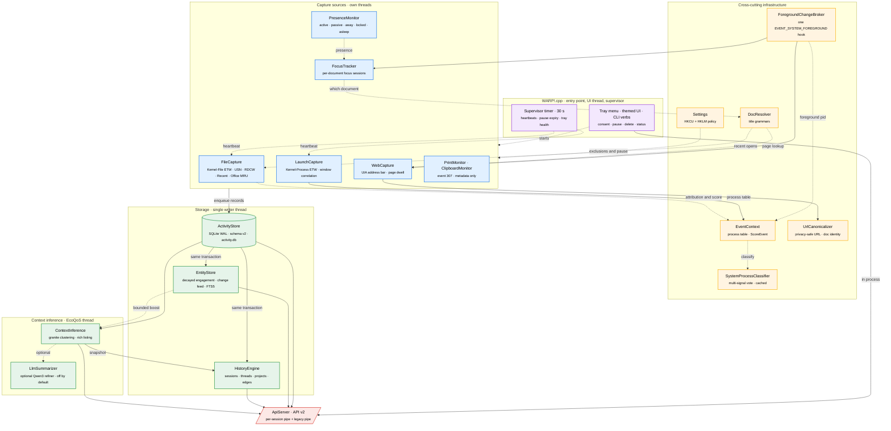
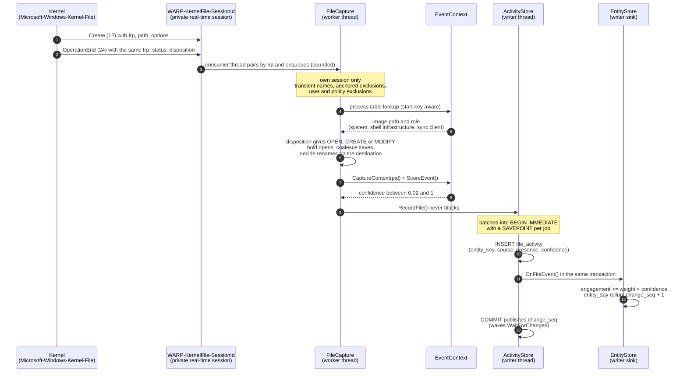
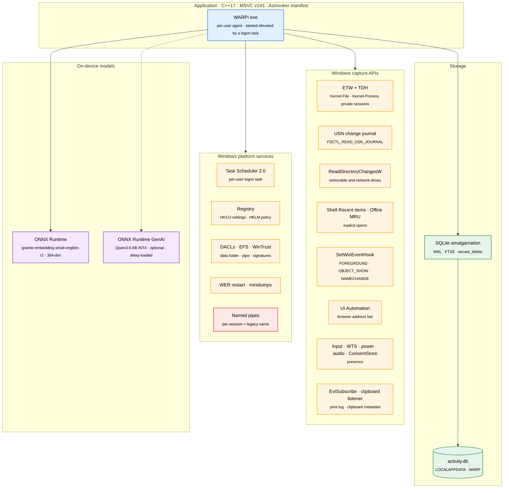

# WARP — Windows Activity Reasoning Platform

[](#installation--runtime)
[](https://www.microsoft.com/windows/)
[](https://isocpp.org/)
[](https://visualstudio.microsoft.com/)
[](https://sqlite.org/)
[](API.md)
[](#contextinference-contextinferenceh--contextinferencecpp)

WARP — the **Windows Activity Reasoning Platform**, version **6.0.0** — is a native
Win32 C++ agent that runs once per user on Windows 10 (version 1709 or later) and
Windows 11, and works entirely on the local PC:

1. **Captures** what the user works with: files (opened, created, saved, downloaded,
   renamed, deleted), app launches and exits, per-document focus sessions with
   active vs idle time, browser pages (privacy-safe canonical URLs and document
   identities), presence (active / passive / away / locked / asleep) and,
   optionally, printed documents and clipboard *metadata*. Every capture source runs
   on its own threads and hands typed records to a single storage writer.

2. **Remembers** it in a versioned SQLite database (schema v2): raw events for
   30 days by default, a per-entity **engagement model** (decayed short- and
   long-term engagement, daily rollups, tombstones, a global change sequence, an
   FTS5 search index) and a **history layer** (work sessions, work threads,
   projects, co-occurrence edges) kept for 395 days by default.

3. **Reasons** over it: every minute a context composer clusters the recent window,
   tab and document titles with the on-device **granite-embedding-small-english-r2**
   encoder and writes a **rich deterministic one-liner** — e.g. *"User is working on
   auth middleware, login handler and session store in Visual Studio Code"* — plus
   per-facet summaries (files / websites / apps), structured `current_entities`
   with roles, and the persistent work-thread id. An optional **Qwen3-0.6B**
   refiner (off by default) may rewrite the line, but only when its output is at
   least as grounded in the actual titles.

Local applications read all of this through a versioned named-pipe API (**API v2**,
backward compatible with v1 requests) on `\\.\pipe\WarpFileActivityAPI-<SessionId>`
(preferred) and the legacy `\\.\pipe\WarpFileActivityAPI`: ranked entities with
human-readable reasons, full-text search, a cursor-based change feed, a timeline,
work threads, related items and the current context. See [API.md](API.md).

WARP runs fully offline — no cloud calls, no telemetry. `WARP!.exe --install`
copies it to `%ProgramFiles%\WARP` and registers a per-user logon scheduled task
that starts it elevated and headless at every sign-in; the user controls it from
the tray icon (status, pause, delete history) or the command line.

---

## Table of contents

- [Features](#features)
- [Event types](#event-types)
- [Architecture](#architecture)
  - [System overview](#system-overview)
  - [Event-capture pipeline](#event-capture-pipeline)
  - [Noise-reduction & confidence pipeline](#noise-reduction--confidence-pipeline)
  - [Component overview](#component-overview)
- [Data model](#data-model)
- [Ranking & engagement model](#ranking--engagement-model)
- [History layer](#history-layer)
- [Privacy & security](#privacy--security)
- [Settings & policy](#settings--policy)
- [Installation & runtime](#installation--runtime)
- [User interface](#user-interface)
- [Building](#building)
- [Testing](#testing)
- [Tech stack](#tech-stack)
- [Query API](#query-api)
- [File layout](#file-layout)
- [Known limitations](#known-limitations)
- [License](#license)
- [Author](#author)

---

## Features

| Feature | Details |
|---|---|
| **Always-on, per-user agent** | `WARP!.exe --install` copies the app to `%ProgramFiles%\WARP` and registers the logon task `\WARP\WARP Agent - <SID>` (highest privileges, `--headless`, restart on failure). One instance per user. The message pump starts first; storage, models and capture start on a worker thread. A 30-second supervisor restarts dead ETW consumers with backoff; a crash writes a minidump and Windows Error Reporting restarts the agent. |
| **File activity** | `FileCapture` merges a private per-session **Microsoft-Windows-Kernel-File** ETW session (Create correlated with OperationEnd, no WRITE keyword), the **NTFS/ReFS USN journal** (edits, deletes and renames, plus up to 72 h of downtime backfill from cursors stored in the database), `ReadDirectoryChangesW` on removable and network drives only, and explicit opens from **Shell Recent items** and **Office MRU** lists (OneDrive/SharePoint URLs mapped to their synced paths). Actions: `OPEN`, `CREATE`, `MODIFY`, `DELETE`, `RENAME`, `DOWNLOAD`. |
| **Save- and download-aware renames** | Renames are decided on the destination: safe saves (`~WRL0001.tmp` → `report.docx`) become `MODIFY`, finished browser downloads (`.crdownload`, `.partial`, `.part`, …) become `DOWNLOAD` with the canonical Mark-of-the-Web origin URL, moves to the Recycle Bin become `DELETE`; repeated saves are coalesced. |
| **App launches & exits** | `LaunchCapture` decodes **Microsoft-Windows-Kernel-Process** with TDH, maintains the process table used for attribution, waits up to 8 s for a user-facing window (also matching windows shown just before the lagging ETW event), skips helper and same-image child processes, and records the creator process, packaged-app **AUMID**, exit time and lifetime. |
| **Per-document focus sessions** | `FocusTracker` splits foreground time per window *and* per document (1 Hz title sampling, 2 s debounce) with active vs idle seconds, closes sessions at the last input when the user goes away, locks or sleeps, and resolves which file or web page the window shows (`DocResolver`). |
| **Browser pages** | `WebCapture` reads the address bar with **UI Automation** on a worker thread (structural, locale-independent, cached per window), canonicalizes URLs (`UrlCanonicalizer`), recognizes document identities (Google Docs/Drive, SharePoint/OneDrive, GitHub, Azure DevOps, YouTube, Figma, Jira) and records per-window page dwell. Private/InPrivate/Incognito windows and sign-in or excluded hosts are never recorded. |
| **Presence** | `PresenceMonitor` classifies the user as *active*, *passive* (no input, but media playing, microphone/camera in use or a full-screen app), *away*, *locked* or *asleep*. Presence never pauses capture: it tags events, closes focus sessions and drives work sessions. |
| **Print & clipboard (optional)** | `PrintMonitor` records printed documents from the PrintService log (event 307). `ClipboardMonitor` (off by default) records clipboard *metadata* only — owner app and coarse formats, never content. |
| **Confidence model** | Every event carries a `[0, 1]` confidence from `EventContextUtil::ScoreEvent` (source class, foreground match, input recency, attribution, process role, event kind, wake boundary). Noisy processes are scored down instead of silently dropped. |
| **Single-writer storage** | `ActivityStore`: one writer thread, batched `BEGIN IMMEDIATE` transactions with per-job savepoints, bounded queue (20 000), 3 pooled readers, `PRAGMA user_version` migrations (v0/v1 → v2 with backfill), `quick_check` + quarantine, global `change_seq`, retention, tombstones, scoped purge and secure clear. |
| **Engagement ranking** | `EntityStore` keeps decayed short-term (τ = 3 days) and long-term (τ = 30 days) engagement per file, app and URL, computes per-type percentile scores at **read** time and explains them (*"edited today"*, *"42 min active in the last 7 days"*). Renames carry history to the new key; deletes become tombstones after a 15 s safe-save grace. |
| **History & context** | `HistoryEngine` builds work sessions, persistent work threads (resumable for 14 days), project anchors and co-occurrence edges. `ContextInference` composes the current context every 60 s (configurable; EcoQoS thread, slower on battery, skipped when nothing changed). |
| **API v2** | Per-session + legacy named pipes with an explicit DACL, caller identification, policy allow-lists and scopes; 8 workers, deadlines, 1 MiB request limit, `api_version` on every response, structured errors. v1 requests keep working. |
| **Privacy controls** | First-run consent, pause (1 h, until tomorrow, or any duration via the CLI), delete the last 15 min / hour / today / everything, exclusions for apps, titles, domains and paths, a protected and optionally EFS-encrypted data directory, IT policy overrides in `HKLM\Software\Policies\WARP`. |
| **Tray, UI and CLI** | Tray menu (status, pause/resume, delete activity), a themed light/dark window with an API explorer, and CLI verbs (`--install`, `--uninstall`, `--status`, `--pause`, `--resume`, `--purge-*`). |

---

## Event types

| Event type (table) | What is recorded | Sources |
|---|---|---|
| **File activity** (`file_activity`) | `OPEN`, `CREATE`, `MODIFY`, `DELETE`, `RENAME`, `DOWNLOAD` of user files and folders, with the source, entity key, download origin URL, presence and confidence. | Kernel-File ETW (private per-session session), USN journal (fixed NTFS/ReFS volumes), `ReadDirectoryChangesW` (removable / network drives), Shell Recent items, Office MRU |
| **App launch** (`app_launch_activity`) | Starts of real apps in the user's session (not helpers), with creator process, AUMID, time to the first user-facing window (`created_window_ms`) and, on exit, `exit_ts` / `lifetime_secs`. | Kernel-Process ETW (TDH) + `EVENT_OBJECT_SHOW` / `EnumWindows` window correlation |
| **App focus** (`app_focus_activity`) | One row per window *and* document: start/end, active and idle seconds, normalized title, resolved document (`doc_key`), window class, virtual desktop, AUMID, presence. | `ForegroundChangeBroker` (`EVENT_SYSTEM_FOREGROUND`) + 1 Hz sampler + `DocResolver` |
| **Browsing** (`browsing_activity`) | Page changes per browser window: title, canonical URL, host, document id/kind, `window_id`, and `dwell_secs` = foreground dwell of the **previous** page in the same window. | Per-browser `EVENT_OBJECT_NAMECHANGE` hook + UI Automation address bar + `UrlCanonicalizer` |
| **Presence** (`presence_interval`) | Intervals of `active` / `passive` / `away` / `locked` / `asleep`. | `GetLastInputInfo`, WTS session and power notifications, audio sessions, microphone/camera ConsentStore, `SHQueryUserNotificationState` |
| **Print** (`print_activity`) | Document name, printer, page count. | `Microsoft-Windows-PrintService/Operational` event 307 (`EvtSubscribe`) |
| **Clipboard** (`clipboard_activity`, opt-in) | Owner executable and coarse formats (`text`, `image`, `files`, `html`, `rtf`, `other`) — never content. | `AddClipboardFormatListener` |

---

## Architecture

WARP is one per-user Win32 process built in four layers. **Capture sources** run on
their own threads (only the WinEvent hooks live on the UI thread) and never touch
SQLite: they enqueue typed records into **`ActivityStore`**, whose single writer
thread commits the raw rows *and* the derived state of its sinks (**`EntityStore`**,
**`HistoryEngine`**) in the same transaction. **`ContextInference`** composes the
current context on a low-priority (EcoQoS) thread, and **`ApiServer`** answers local
clients from pooled read-only connections. The UI calls the API in-process; the CLI
uses the per-session pipe.

### System overview



### Event-capture pipeline

A file event travels from the kernel through correlation, filtering, attribution
and scoring into the store and the engagement model. Launches, focus sessions and
web pages follow the same shape; only the source and the producer-specific rules
differ (table below).



| Source | Runs on | Becomes |
|---|---|---|
| Kernel-File ETW (`WARP-KernelFile-<session id>`) | ETW consumer thread → `FileCapture` worker | `OPEN` / `CREATE` / `MODIFY` from the create disposition; confirmed `DELETE` / `RENAME` |
| USN journal (fixed NTFS/ReFS volumes, read every 2 s) | `UsnJournalReader` thread | `CREATE` / `MODIFY` / `DELETE` on handle close and `RENAME`, attributed to the process that recently opened the path; replays up to 72 h missed while WARP was not running |
| `ReadDirectoryChangesW` | `FileCapture` RDCW reader | changes on removable and network drives |
| Shell Recent items, Office MRU | `RecentItemsWatcher` (STA thread), `OfficeMruReader` (60 s poll) | explicit user `OPEN` |
| Kernel-Process ETW (`WARP-Process-<session id>`) | ETW consumer + 500 ms correlation sweeper | a launch row once a user-facing window shows (≤ 8 s) or the deadline passes; exit time and lifetime |
| `EVENT_SYSTEM_FOREGROUND` + 1 Hz sampler | UI-thread hook + `FocusTracker` sampler thread | a focus row when focus moves, the title settles on a new document (2 s) or presence changes |
| `EVENT_OBJECT_NAMECHANGE` on the foreground browser | UI-thread hook → UI Automation worker | a browsing row per page change (250 ms per-window debounce) |
| Presence, print, clipboard | own threads / event-log callback | `presence_interval`, `print_activity`, `clipboard_activity` rows |

### Noise-reduction & confidence pipeline

Every stored row carries one `confidence` value in `[0, 1]` that summarizes what
WARP knows about whether the user caused the event. Clear non-user activity is
dropped *before* scoring (other sessions, system and transient paths, private or
excluded content, helper processes); everything else is **scored, not dropped**, by
`EventContextUtil::ScoreEvent`, which multiplies a source prior by foreground,
input-recency, attribution, process-role and event-kind factors and finally by the
context factors already in the event (wake boundary, unconfirmed ETW).
`EntityStore` then weights every piece of evidence by that confidence.

```mermaid
flowchart LR
    classDef high     fill:#34a853,color:#fff,stroke:#1e8e3e,stroke-width:2px
    classDef med      fill:#fbbc04,color:#000,stroke:#f9ab00,stroke-width:2px
    classDef low      fill:#ea4335,color:#fff,stroke:#c5221f,stroke-width:2px
    classDef veryLow  fill:#5f6368,color:#fff,stroke:#3c4043,stroke-width:2px
    classDef store    fill:#e8eaed,color:#000,stroke:#5f6368,stroke-width:1.5px
    classDef agg      fill:#e6f4ea,color:#000,stroke:#1e8e3e,stroke-width:1.5px

    subgraph Gate ["1 · Dropped before scoring"]
        direction TB
        G1["Other Windows sessions"]:::veryLow
        G2["Transient names · system, temp,<br/>AppData, tool and build paths"]:::veryLow
        G3["Private windows · excluded apps,<br/>titles, domains and paths"]:::veryLow
        G4["Helper processes<br/><sub>same image as parent · brokers</sub>"]:::veryLow
    end

    subgraph Prior ["2 · Source prior"]
        direction TB
        P1["Focus session · 1.0"]:::high
        P2["Recent items · Office MRU · 0.95"]:::high
        P3["UI Automation page · 0.9"]:::high
        P4["Kernel-File ETW · 0.75<br/>USN journal · 0.7<br/>ReadDirectoryChangesW · 0.6"]:::med
    end

    subgraph Mod ["3 · Factors"]
        direction TB
        M1["Foreground match<br/>+0.25 same process · +0.2 same exe"]:::high
        M2["Input recency, observed sources<br/>≤ 10 s ×1 · ≤ 60 s ×0.85 · ≤ 5 min ×0.7 · older ×0.5"]:::med
        M3["Process role<br/>system ×0.2 · shell infrastructure ×0.35<br/>sync client ≤ 0.3 · unattributed ≤ 0.5"]:::low
        M4["Event kind<br/>launch with window ≥ 0.85 · without ×0.4<br/>download ≥ 0.6 · delete or rename ×0.9<br/>background open ×0.8"]:::med
        M5["Context<br/>wake boundary ×0.2 · unconfirmed ETW ×0.5"]:::low
    end

    C["confidence<br/><sub>clamped 0.02 to 1 · stored on every row</sub>"]:::store

    subgraph Agg ["4 · EntityStore"]
        direction TB
        A1["evidence weight × confidence<br/><sub>explicit open 1.5 · passive open 0.3 · edit 3.0<br/>active minute 1.0 · web visit 0.5</sub>"]:::agg
        A2["de-duplication windows<br/><sub>passive opens 2 min · edits, launches, visits 60 s</sub>"]:::agg
        A3["decayed engagement<br/><sub>short τ 3 days · long τ 30 days</sub>"]:::agg
    end

    Gate -- survivors --> Prior
    Prior --> Mod
    Mod --> C
    C --> Agg
```



> **Why score instead of drop?** Hard filters either leak noise or lose real work
> (a build that saves 40 files, a sync client touching a document the user just
> edited). Scoring keeps every plausible event at a commensurate weight: a stream
> of *n* events at confidence *c* contributes about *n × c*, so dim signals still
> count a little and nothing is ranked from a single background touch. Raw rows
> keep their confidence, so API clients can filter with `min_confidence`.

### Component overview

Components fall into five groups: the **application shell**, the **capture
sources**, the **cross-cutting infrastructure** they share, the **storage and
analytics** layer, and the **query surface**.

> **Application shell**

#### `WARP!.cpp` — process model, tray, UI and CLI

The Win32 entry point (`WARP_PRODUCT_VERSION` = `6.0.0`).

- **Process model.** The manifest is `AsInvoker`; the logon task created by
  `--install` runs the agent elevated with `--headless`. `SetDefaultDllDirectories`
  limits DLL loading to the application directory and System32. A per-user mutex
  (`Local\WARP-<SID>`) keeps one instance per user — a second launch only surfaces
  the first one's window. The message pump starts first; `StartSubsystems()` opens
  the store, presence, file / launch / print / clipboard capture, the models and
  the API on a worker thread, then the UI thread installs the WinEvent hooks
  (`ForegroundChangeBroker`, `EVENT_OBJECT_SHOW` for launch correlation) and starts
  `WebCapture`, `FocusTracker` and `ContextInference`.
- **Timers.** A 30-second supervisor calls `FileCapture::Heartbeat()` and
  `LaunchCapture::Heartbeat()` (restart dead ETW consumers with backoff, poll lost
  events), applies pause expiry and refreshes the tray tooltip (*recording*,
  *paused until …* or *degraded: files / launches / storage / backlog*). A 6-hour
  timer schedules store maintenance on the writer thread; maintenance also runs
  once at startup.
- **Lifecycle.** `WM_ENDSESSION` (sign-out, shutdown) flushes the open focus
  session and drains the writer queue. The installer asks a running agent to exit
  through the event `Local\WARP-ShutdownRequest`.
- **First run.** A consent dialog explains what is recorded; declining starts
  WARP paused.
- **Tray and CLI.** See [Installation & runtime](#installation--runtime).

**Main window** (opened maximized when restored from the tray):

- **Header row** -- status label on the left, theme toggle and clear history buttons
  on the right, separated from the body by an accent-colored horizontal line.
- **Predefined query section** -- 9 owner-drawn buttons ("Last 15 min" through
  "Last 30 days") that wrap responsively based on window width.
- **Custom seconds section** -- a numeric edit field and "Send Custom Query" button.
- **Default query section** -- a single button that sends an empty `{}` request
  (returns last 1 hour).
- **Event type filter** -- four checkboxes (**File Activity**, **App Launches**,
  **App Focus**, **Browsing Activity**) that control which event types are queried.
  All checked by default. The selected types are sent as a `"types"` array in the
  JSON request.
- **Inference exploration section** -- labelled "Explore Precomputed Inferences":
  - *Entity type filter* -- three checkboxes (**Files**, **Apps**, **URLs**) to
    select which entity types to include. All checked by default.
  - *Top N* -- a numeric input (default 50) and a **Show Top Inferences** button
    that calls `TopEntities` (one entity type, or all types merged by percentile)
    and formats a report with rank, type, engagement score, 7-day opens and active
    minutes, distinct days, display name, reasons and local-time timestamps.
  - *Lookup* -- a text field with cue banner "Enter path or URL to look up..." and
    a **Lookup** button that sends `ScoreEntities` (with `"context": "current"`)
    for the entered path or URL and shows the scored record, its reasons and its
    current-thread boost.
- **Context section** -- **Show Context Summary** (`GetRecentContext`) and
  **Show Summary History (last 10)** (`GetRecentContexts`), with a facet drop-down
  (All / Files / Websites / Apps) and a lookback drop-down (5 minutes to 30 days,
  default 15 minutes).
- **Response area** -- a read-only, scrollable, monospace (`Cascadia Mono`) edit
  control that displays pretty-printed JSON responses or the inference explorer
  output.

Each button runs its request on a background thread through `ApiServer::Handle()`
in-process (the same code path pipe clients use, with all scopes), pretty-prints
the response, then marshals it back to the UI thread via a custom
`WM_USER` message -- so the interface never freezes. After pretty-printing,
`AnnotateTimestamps()` walks the result line by line and appends a
`// YYYY-MM-DD HH:MM:SS` comment to any line that declares a known epoch-
seconds field (`timestamp`, `last_event_ts`, `last_open_ts`, `last_edit_ts`,
`updated_at`, `first_seen_ts`, `window_start`, `window_end`,
`created_window_ms`). Implausible values (zero, version numbers, recency
scores) are left untouched, and conversion uses `localtime_s` so the displayed
time matches the user's wall clock.

The UI supports two themes (**light** and **dark**) switchable at runtime via the
toggle button. All colors are defined in a `Theme` struct; switching recreates the
GDI brushes and issues a full `RedrawWindow` with `RDW_ALLCHILDREN`.

Closing or minimizing the window hides it back to the tray; only **Exit** from the
tray menu terminates the process.

#### `Installer` (`Installer.h` / `Installer.cpp`)

`Install()` (run elevated by `WARP!.exe --install`) asks running instances in the
session to exit, copies the folder of the running executable (all files and
subfolders, including `models\`) to `%ProgramFiles%\WARP` — admin-writable only —
and registers the Task Scheduler task **`\WARP\WARP Agent - <user SID>`**: logon
trigger for that user with a 15 s delay, interactive token, **highest** run level,
action `WARP!.exe --headless`, no execution time limit, new instances ignored while
one runs, restart on failure 3 times at 1-minute intervals, allowed on battery. The
task is then started. `Uninstall()` signals running instances (waits up to 10 s),
deletes the task, removes the install directory (files in use are deleted at the
next reboot) and, with `--remove-data`, deletes `%LOCALAPPDATA%\WARP`.

#### `Settings` (`Settings.h` / `Settings.cpp`)

Thread-safe effective configuration, layered *defaults ← `HKCU\Software\WARP` ←
`HKLM\Software\Policies\WARP`* (64-bit view). Policy values win and are **locked**:
WARP's tray, CLI and API cannot change them. The module also owns the exclusion
matchers (`IsExcludedApp`, `IsExcludedTitle`, `IsExcludedDomain`,
`IsExcludedPath`), the pause state and the consent flag. Every value is listed
under [Settings & policy](#settings--policy).

#### `Logger` and `CrashHandler`

`Log` writes a rotating UTF-8 log (`%LOCALAPPDATA%\WARP\logs\warp.log`, rolled at
5 MB, 5 files) and keeps the most recent warnings and errors in memory for
`GetStatus`. `CrashHandler` installs unhandled-exception, invalid-parameter,
pure-call and terminate handlers that write a minidump to
`%LOCALAPPDATA%\WARP\dumps` (newest 5 kept) and registers the process with Windows
Error Reporting, which restarts it with `--headless --restarted` after a crash or
hang (WER restarts processes that ran for at least 60 s).

> **Capture sources**

#### `FileCapture` (`FileCapture.h` / `FileCapture.cpp`)

File activity from five sources, each enabled by settings and supervised
independently (the `source` column records which one produced a row):

| Source | What it contributes |
|---|---|
| `etw` | A private real-time session `WARP-KernelFile-<session id>` on **Microsoft-Windows-Kernel-File**, filtered to WARP's own Windows session. *Create* (12) is paired by `Irp` with *OperationEnd* (24): only successful, non-directory creates count, and the create disposition decides `OPEN` / `CREATE` / `MODIFY`. *DeletePath* (26) and *RenamePath* (27) are confirmed the same way. The **WRITE keyword is not enabled** — edits come from dispositions and the USN journal. Events are decoded with TDH by property name; if OperationEnd correlation is unavailable the source runs in a degraded *unconfirmed* mode at half confidence. |
| `usn` | `UsnJournalReader` reads the NTFS/ReFS change journal of every fixed volume (read-only, every 2 s): creates, modifications and deletes on handle close, and renames, attributed to the process that recently opened the path (from ETW). Per-volume cursors are stored in the database `meta` table, so changes made while WARP was not running are backfilled (up to 72 h). |
| `rdcw` | `ReadDirectoryChangesW` on **removable and network drives only**; the heartbeat adds newly mounted drives. |
| `recent` | `RecentItemsWatcher` watches the Shell *Recent Items* folder: every new or refreshed `.lnk` is an explicit user `OPEN` (backfilled from the last high-water mark). |
| `mru` | `OfficeMruReader` polls the Word, Excel, PowerPoint, Visio, Access and Publisher *File MRU* lists every 60 s; OneDrive/SharePoint URLs are mapped to their synced local path by `OneDriveMapper` when possible. |

Processing on one worker thread:

- **Path rules** (`ClassifyPath`): *transient* names (Office `~$…` / `~WRL*`,
  `*.tmp`, `*.crdownload`, `*.partial`, `*.part`, editor swap and backup files,
  JetBrains and Excel temp names, …) and *excluded* locations — anchored to the
  resolved known folders (Windows, Program Files, ProgramData, AppData, temp),
  volume-root system folders, the Recycle Bin, tool/VCS dot-directories (`.git`,
  `.vs`, `.vscode`, …), build outputs (`obj`, `node_modules`, `bin\Debug`, …),
  mailbox/database stores and system files. A small AppData re-admit list keeps
  Office UnsavedFiles, Visual Studio backup files, Notepad++ backups and OneNote
  `.one` files. `ExcludedPathPrefixes` and `ExcludedApps` apply on top.
- **Renames are decided on the destination** (`DecideRename`):

  | Source → destination | Recorded as |
  |---|---|
  | user → Recycle Bin | `DELETE` of the source |
  | user → user | `RENAME` |
  | user → transient | nothing (first step of a safe save) |
  | user → excluded | `DELETE` of the source |
  | transient → user | `MODIFY` of the destination (`DOWNLOAD` when it completes a browser download) |
  | excluded → user | `CREATE` of the destination, upgraded to `DOWNLOAD` when it carries a Mark-of-the-Web |

- **Downloads** carry their canonical, privacy-filtered origin (`HostUrl`, else
  `ReferrerUrl` from the `Zone.Identifier` stream, read by `ZoneIdentifier`).
- **Attribution and scoring.** Each event is attributed through the process table
  (start-key aware, so a recycled PID never lends its image), classified by
  process role — system, shell infrastructure (indexer, preview handlers,
  antivirus, …) or sync client (OneDrive, Dropbox, Google Drive, …) — and scored
  by `ScoreEvent`; noisy roles are kept at low confidence instead of being dropped.
  Opens are held briefly and repeated saves are coalesced (3 s), so an autosave
  burst becomes one `MODIFY`.
- **Bounded queues and health.** The ETW queue holds up to 50 000 events; polled
  sources apply back-pressure instead of dropping. `Heartbeat()` restarts a dead
  ETW consumer with backoff (30 s up to 10 min), polls `EventsLost` /
  `RealTimeBuffersLost`, and refreshes the device map and RDCW roots.
  `GetStats()` feeds `GetStatus` and the tray tooltip.
- `SetPaused(true)` is a **privacy** pause: events are read and discarded (USN
  cursors still advance, so nothing is replayed later). Idleness never pauses
  capture.
- `RecentPathsForPid()` and `RecentExplicitOpens()` let the focus tracker resolve
  which document a window shows.

#### `LaunchCapture` (`LaunchCapture.h` / `LaunchCapture.cpp`)

A private `WARP-Process-<session id>` session on **Microsoft-Windows-Kernel-Process**.
`ProcessStart` payloads are decoded with TDH (process id, parent, session, create
time, image name, package identity); the event *header* PID — the creator, e.g.
`explorer.exe` for a Start-menu launch — is kept as `creator_pid` / `creator_exe`.

- Every start and stop feeds `EventContextUtil`'s **process table**, which file
  attribution relies on (it survives process exit and detects PID reuse by start
  key).
- Only processes in WARP's own session are recorded. Helpers (`conhost`,
  `dllhost`, `RuntimeBroker`, WebView2, crash handlers, …) and children with the
  same image as their parent (browser renderers, Electron helpers) are not
  launches; hard-blocked or `SystemProcessClassifier`-system images and excluded
  apps are skipped. Real tools (cmd, PowerShell, Task Manager, installers) are
  kept.
- Each launch is **parked** until a user-facing window shows (visible, root,
  unowned, not a tool window, not cloaked, non-zero size), reported by the UI
  thread's `EVENT_OBJECT_SHOW` hook. Windows that already existed, or were shown up
  to 10 s *before* the lagging ETW event, match too, and a final `EnumWindows`
  check runs at the 8 s deadline. Launches with a window score at least 0.85;
  launches without one are kept at ×0.4.
- Packaged apps carry their **AUMID** (the app entity key prefers it, so updates
  don't split history); process exits fill `exit_ts` and `lifetime_secs`.
- `Heartbeat()` restarts a dead consumer with backoff and polls lost events;
  `SetPaused(true)` records nothing but keeps the process table current.

#### `FocusTracker` (`FocusTracker.h` / `FocusTracker.cpp`) and `DocResolver`

Per-document focus sessions. The tracker subscribes to `ForegroundChangeBroker`
and samples the foreground window once per second:

- A session ends when focus moves, the window closes, or the window's normalized
  title changes and stays changed for 2 s — switching documents inside one window
  produces one row per document. Sessions shorter than 1 s are discarded.
- **Active vs idle.** Each second counts as active, or as idle when there has been
  no input for more than 2 minutes — unless presence is *passive* (media, a call,
  a full-screen app), which counts as active.
- **Presence-aware closing.** *Away*, *locked* and *asleep* close the session at
  the last input time; while away there is no current session (no fictional
  dwell).
- The `EventContext` is captured at session **start**, not at emit time (when the
  broker already names the next app).
- **Document resolution** (wired in `WARP!.cpp`): a browser window resolves to the
  page `WebCapture` last read for it, if the page title matches the window title;
  a document app resolves to the file whose name `DocResolver` extracts from the
  title with per-app title grammars (`"Report - Word"` → `Report`,
  `"auth.cpp - repo - Visual Studio Code"` → `auth.cpp`) and that the same process
  opened in the last 6 h — or, failing that, a recent explicit open (24 h).
- **Redaction callbacks:** excluded apps produce no row; private-browsing windows,
  excluded pages and excluded titles keep the app time but drop the title and
  the document.
- File Explorer folder windows (`CabinetWClass`) are tracked; shell chrome
  (taskbar, Start, lock screen, …) is not. Rows also carry the window class, the
  virtual desktop id and the AUMID (`DesktopInfo`).

#### `WebCapture` (`WebCapture.h` / `WebCapture.cpp`), `AddressBarReader`, `UrlCanonicalizer`

- **Threads.** The UI thread receives foreground changes and owns one scoped
  `EVENT_OBJECT_NAMECHANGE` hook for the foreground browser process plus a
  message-only window. One MTA worker owns every UI Automation object, debounces
  per window (250 ms, latest request wins), reads the address bar and applies the
  privacy rules.
- **Browsers.** 18 known Chromium/Gecko browsers (Chrome, Edge, Firefox, Brave,
  Opera, Vivaldi, Arc, Zen, Floorp, LibreWolf, Waterfox, Yandex, Thorium,
  Chromium, DuckDuckGo, Whale, Sidekick, Mercury); other Chromium/Gecko-class
  windows are probed at runtime, while Electron apps (VS Code, Teams, Slack, …)
  are not treated as browsers.
- **Address bar.** `AddressBarReader` finds the omnibox structurally and
  locale-independently (Chromium `OmniboxViewViews`, Gecko `urlbar-input`, else an
  edit under a toolbar) with a bounded walk that never descends into web content,
  caches the element per window (steady-state reads are one cross-process call)
  and uses UIA connection/transaction timeouts (500 ms). If the omnibox has
  keyboard focus (the user may be typing) the read is retried once, then the page
  is recorded title-only.
- **Private windows are never recorded** (`DropPrivateBrowsing`): InPrivate,
  Incognito, Private Browsing and Tor windows are detected from UIA markers, the
  window title and the process command line; a window whose privacy cannot be
  verified is treated as private (fail closed).
- **URL canonicalization** (`UrlCanon::Canonicalize`): fragments and user info are
  removed; query strings are dropped except a small per-host allow-list (YouTube
  `v` / `list`, SharePoint `sourcedoc` / `id` / `file`) plus `UrlQueryAllowlist`;
  sensitive keys and search terms are never kept; token-like path segments become
  `:token`. **Document identities** are recognized for Google Docs / Drive,
  SharePoint and OneDrive, GitHub PRs / issues / repositories, Azure DevOps work
  items and PRs, YouTube, Figma and Jira, so a document keeps one entity key
  whatever URL variant is open. Sign-in and password-manager hosts, online-banking
  and patient-portal hosts and `ExcludedDomains` are **excluded**: such pages are
  not recorded. Placeholder pages ("New Tab", "Untitled") are skipped.
- **Dwell.** Each window keeps a foreground clock (paused time excluded). When a
  new page is recorded, its row's `dwell_secs` is the dwell of the **previous**
  page in the same window (`window_id`); title churn on the same page is ignored.
- `LookupPage()` and `IsPrivateWindow()` let the focus tracker attach the URL
  entity to focus sessions and redact private windows.

#### `PresenceMonitor` (`PresenceMonitor.h` / `PresenceMonitor.cpp`)

One thread with a message-only window (session lock/unlock, suspend/resume and
power-setting notifications) polls input every 2 s and refreshes the passive
signals every 5 s:

| State | Meaning |
|---|---|
| `active` | keyboard/mouse input within `AwayAfterSeconds` (default 300 s) |
| `passive` | no recent input, but audible media playback, microphone or webcam in use, or a full-screen / presentation app |
| `away` | no input and no passive signal (passive signals are ignored once the display has been off longer than the away threshold) |
| `locked` | session locked or disconnected (console or remote) |
| `asleep` | system suspended |

Precedence: asleep > locked > active > passive > away. On resume it arms a
5-second **wake boundary** in `EventContext` (confidence ×0.2 for the burst of
post-wake housekeeping I/O). Transitions are written to `presence_interval`, tag
every event (`presence` column) and drive focus-session closing and work sessions.
Presence never pauses capture.

#### `PrintMonitor` and `ClipboardMonitor`

- `PrintMonitor` (`CapturePrint`, on by default) subscribes with `EvtSubscribe` to
  `Microsoft-Windows-PrintService/Operational` event 307 (*document printed*) and
  records document name, printer and page count. That log channel is disabled by
  default in Windows; WARP enables it (it runs elevated) and leaves it enabled.
- `ClipboardMonitor` (`CaptureClipboardMetadata`, **off by default**) registers
  `AddClipboardFormatListener` on its own thread and coalesces bursts (250 ms).
  It never opens the clipboard: it records the clipboard owner's executable and the
  coarse formats on offer.

Both tables follow raw retention, purge and clear; no API operation serves them in
6.0.0.

> **Cross-cutting infrastructure**

#### `ForegroundChangeBroker` (`ForegroundChangeBroker.h` / `ForegroundChangeBroker.cpp`)

A single `SetWinEventHook(EVENT_SYSTEM_FOREGROUND, …, WINEVENT_OUTOFCONTEXT)` on
the UI thread. Subscribers (`FocusTracker`, `WebCapture`) register a callback with
`Subscribe()`; the broker invokes them the moment Windows promotes a new window,
and records the foreground PID for `EventContextUtil::CaptureContext()`, so worker
threads (ETW callbacks) can attribute events without calling
`GetForegroundWindow()` themselves.

#### `EventContext` (`EventContext.h` / `EventContext.cpp`)

The attribution payload stored with every activity row (the nine EventContext
columns):

| Field | Meaning |
|---|---|
| `sourcePid` / `sourceExe` | The process that caused the event. |
| `foregroundPid` / `foregroundExe` | The process owning the foreground window at that moment (from the broker). |
| `parentPid` / `parentExe` | The parent process (launches). |
| `msSinceInput` | Milliseconds since the last keyboard / mouse input (`GetLastInputInfo`). |
| `createdWindowMs` | Launches: ms from process start to the first user-facing window (0 = none seen). |
| `confidence` | `[0, 1]` likelihood that the user caused the event. |

`EventContextUtil` also provides:

- the **process table** fed by `LaunchCapture` (pid, parent, session, start key,
  start/exit time, image path) and an LRU image-path cache — attribution survives
  process exit, and PID reuse is detected by the start key;
- **own-session checks** (`OwnSessionId`, `IsOwnSession`, `IsOwnSessionPid`) used by
  every capture source, because events from other Windows sessions belong to other
  users or desktops;
- `CaptureContext(pid)`, which applies the ×0.2 wake boundary, and the
  **`ScoreEvent` confidence model** shown in the
  [confidence pipeline](#noise-reduction--confidence-pipeline). `ScoreEvent`
  multiplies into the existing confidence; it never assigns.

#### `SystemProcessClassifier` (`SystemProcessClassifier.h` / `SystemProcessClassifier.cpp`)

A multi-signal vote — **3 signals out of 7** mark a process as system: a well-known
name blocklist, an image under the Windows tree (`System32`, `SysWOW64`,
`SystemApps`, `WinSxS`, `Servicing`, Windows Defender, …), a system parent
(`services.exe`, `svchost.exe`, `smss.exe`, `wininit.exe`, `csrss.exe`, System),
session 0, high integrity (counted only together with a system parent) and an
Authenticode signature by a Microsoft Windows publisher; window evidence is applied
separately by `ScoreEvent`. Static signals (path, signature, name) are cached per
executable path; per-process signals per (PID, process start key) for 10 minutes,
so a recycled PID is always re-evaluated. File capture turns the verdict into a
confidence penalty; launch capture skips system processes.

#### `DesktopInfo`, `EntityKey`, `Json`

- **`DesktopInfo`** — virtual-desktop id (`IVirtualDesktopManager`), DWM cloaking,
  full-screen / presentation state, monitor name, window and process **AUMID**, and
  the "user-facing app window" test.
- **`EntityKey`** — the single canonicalization of entity identity shared by every
  producer and consumer: Windows paths (`\\?\`, UNC, device paths, `.` / `..`, 8.3
  short names, alternate data streams), case-folded UTF-8 keys, `aumid:` app keys
  and prefixed document keys. The same functions are registered in SQLite
  (`warp_key`, `warp_file_key`) so SQL and C++ always agree.
- **`Json`** (`WarpJson`) — a strict RFC 8259 parser (exact int64, depth limit,
  invalid UTF-8 rejected, last duplicate key wins) and a writer that always emits
  valid UTF-8 JSON.

> **Storage and analytics**

#### `ActivityStore` (`ActivityStore.h` / `ActivityStore.cpp`)

The persistence layer for `%LOCALAPPDATA%\WARP\activity.db` (tables under
[Data model](#data-model)):

- **One writer thread** owns the writer connection. Producers call
  `RecordFile`, `RecordLaunch`, `RecordProcessExit`, `RecordBrowse`, `RecordFocus`,
  `RecordPresence`, `RecordClipboard` or `RecordPrint`, which enqueue a job and
  return immediately (bounded queue of 20 000; a full queue drops and counts the
  record). Jobs are batched (up to 512, with a short wait to let bursts
  accumulate) into `BEGIN IMMEDIATE … COMMIT` with cached prepared statements and
  a **savepoint per job**, so a failing job rolls back alone. Registered
  `IWriterSink`s (`EntityStore`, `HistoryEngine`) run inside the same transaction:
  raw rows and derived state commit atomically and in order.
- **Reads** use a pool of 3 read-only connections; in WAL mode readers never block
  the writer.
- **Schema versioning** with `PRAGMA user_version`: v0/v1 databases (the legacy
  four activity tables + `inference`) migrate to v2 in one transaction — new
  columns and tables, backfill of entity keys and event times, re-canonicalization
  of stored URLs (excluded URLs are deleted first), re-keying and merging of the
  old `inference` rows, daily rollups from the retained history and seeded
  engagement. `PRAGMA quick_check` runs at open; a corrupt or unmigratable file is
  quarantined (`activity.db.corrupt-<time>` / `.migrate-failed-<time>`) and
  recreated, so the agent is never left without a store.
- **Change feed.** A global, monotonic `change_seq` is published at commit and
  backs `WaitForChange()`; a clear-all records `reset_seq` so consumers know to
  resync.
- **Maintenance, purge and clear** run on the writer thread, so they never race
  with in-flight inserts: retention, tombstone pruning, incremental vacuum and a
  WAL checkpoint; `Purge()` by time range, entity, web domain or path prefix; and
  `ClearAll()` — delete everything, then truncate the WAL and `VACUUM`.
- **Pragmas:** `journal_mode=WAL`, `synchronous=NORMAL`, `secure_delete=ON`,
  `journal_size_limit` 64 MiB, `temp_store=MEMORY`, incremental `auto_vacuum`.
  SQLite is built with `SQLITE_ENABLE_FTS5`; search falls back to `LIKE` when FTS5
  is unavailable.

#### `EntityStore` (`EntityStore.h` / `EntityStore.cpp`)

An `IWriterSink` that turns raw events into per-entity engagement for files, apps
and URLs (write-through cache on the writer thread), and serves `Lookup`, `Score`,
`Top`, `Search` and `GetChanges` from the read pool. See
[Ranking & engagement model](#ranking--engagement-model).

#### `HistoryEngine` (`HistoryEngine.h` / `HistoryEngine.cpp`)

An `IWriterSink` for focus and presence events plus the snapshot recorder used by
`ContextInference`: work sessions, work threads, project anchors, co-occurrence
edges and persisted context snapshots. See [History layer](#history-layer).

#### `ContextInference` (`ContextInference.h` / `ContextInference.cpp`)

A **dynamic, sentence-encoder-clustered** context composer that reads recent
activity from `ActivityStore` and composes a **context summary** (since v5.17, a
single rich deterministic line per facet)
describing what the user is actively doing — using the actual document names,
browser tab titles, and application titles observed, **not** a fixed list of
pre-defined topic buckets.

**Lifecycle:**

1. `Init(modelsDir)` — `modelsDir` is the `models\` folder next to the executable
   (see the elevation model under [Privacy & security](#privacy--security)). It
   looks for the granite ONNX model at
   `<modelsDir>\granite\model_quantized.onnx` plus its flat tokenizer
   files (`vocab.txt`, `merges.txt`, `special_tokens.txt`, extracted at
   build time from upstream `tokenizer.json`). If all files are present,
   loads the `ModernBertTokenizer` (byte-level BPE) and creates an ONNX
   Runtime session pinned to the CPU provider; otherwise the engine
   reports `model="deterministic"` and skips the embedding pass entirely.
   **Loading failure is never fatal.** Embeddings are cached (LRU, 1 024 texts).
2. `Start(store, focusTracker)` / `Stop()` — runs a background thread at low
   priority (**EcoQoS**). `SetEntityStore`, `SetHistoryEngine`,
   `SetPresenceProvider` and `SetLlmSummarizer` wire in the collaborators.
3. Every `ContextCadenceSeconds` (default **60 s**, 15–3600; doubled on battery
   or battery saver) `RunOnce()` runs — unless capture is paused, or nothing new
   was committed and the same window is still in front (then it refreshes at most
   every 5 minutes):
   - Reads the file, app-launch and browsing rows and the focus sessions
     **overlapping** the last **15 minutes** from `ActivityStore`, clipping each
     session's active seconds to the part inside the window (deleted, renamed-away
     and low-confidence file rows are ignored).
   - Overlays the user's **currently-active** foreground session via
     `FocusTracker::GetCurrentSession()` (with its resolved document; nothing
     while the user is away) — counted as a virtual focus row
     starting at `max(session_start, window_start)`. This fixes the blind spot
     where a user parked >15 minutes in one window would otherwise produce zero
     focus rows in the query.
   - Buckets activity per executable. For each exe, runs a **3-layer classifier**:
     1. **Exact match** against `kAppClasses[]` (~80 entries: Visual Studio, VS
        Code, Notepad++, JetBrains IDEs, Office apps, Outlook, Teams, Slack,
        browsers, PDF readers, notes apps, terminals, design tools, media
        players).
     2. **Path heuristic** for vendor folders (`\jetbrains\`, `\toolbox\apps\`,
        `\microsoft visual studio\`, `\code - insiders\`, `\microsoft office\`,
        `\microsoft\edge`, `\google\chrome`).
     3. **Fallback** — exe basename minus `.exe`, with the verb *"Working in"*.
   - Picks the **most recent / longest-dwell title** for each exe and runs it
     through `CleanTitle()`: normalises UTF-8 em-dash, en-dash, bullet, and `|`
     to ` - ` separators; strips leading status glyphs (●, `* `); pops trailing
     and leading segments matching the app's friendly name or the `kStripSuffixes`
     list (~50 noisy suffixes); and length-caps at 80 characters with a UTF-8
     ellipsis.
   - For browsers, the *cleaned active tab title* (from `BrowsingActivity`) takes
     precedence over the window title.
   - **Bounded historical boost.** With the `EntityStore` connected, each item's
     in-window focus seconds are multiplied by `1 + 0.5 × short-horizon
     engagement percentile` (1.0×–1.5×): history breaks ties between equally
     focused items, but 10 focused minutes always beat 6 minutes on a "popular"
     entity, and zero in-window focus stays zero.
   - **Dynamic semantic clustering (sentence-encoder path).** The composed per-app phrase
     `<verb> "<title>" in <friendlyName>` for the top-8 ranked apps is fed
     through the byte-level BPE tokenizer and the granite ONNX model
     (`ibm-granite/granite-embedding-small-english-r2`, ModernBERT, 384-dim,
     ~47 M params, COIR-trained on code retrieval). The model exposes
     a pre-pooled `sentence_embedding` output that is L2-normalised
     directly. A greedy single-pass clusterer compares each new vector
     to the centroid of every existing cluster and joins the first one with
     **cosine similarity ≥ 0.65**, otherwise opens a new cluster. The cluster
     centroid is updated as a running mean. There are **no pre-defined topic
     labels** — the threads of work emerge from whatever the user is actually
     doing in the rolling 15-minute window.
   - **Semantic theme extraction (per cluster).** For each cluster the
     cleaned member titles are tokenized into *content tokens* — split on
     whitespace, punctuation, **and camelCase** (`ContextInference` →
     `context` + `inference`); then filtered against a **stop-word** list
     (articles, low-information verbs / nouns, dates, generic UI words),
     a **file-extension** list (`cpp`, `docx`, `pdf`, …), and a **brand**
     list (`Visual Studio`, `Edge`, `GitHub`, `YouTube`, `PowerShell`, …
     — also matched on the *un-split* form so `YouTube` doesn't leak as
     `Tube`). Each surviving token is scored by
     `frequency × (1 + cosine(token-embedding, clean-cluster-centroid))`,
     where the *clean cluster centroid* is the sentence-encoder embedding of the
     joined content-token bag. The top **1–2** tokens (the second is
     dropped if its score is < 60 % of the first or if one is a prefix of
     the other) become the cluster's **theme phrase**, ordered by their
     first appearance and Title-Cased. *(v5.17: this theme phrase is no
     longer surfaced to the user — it is retained only as a compact topic
     **hint** for the optional LLM refiner; the user-facing summary is the
     rich deterministic listing described below.)*
   - **Activity verb selection.** A small, fixed verb vocabulary —
     `Working on`, `Reviewing`, `Reading about`, `Researching`,
     `Discussing`, `Watching`, `Designing`, `Reading` — is chosen per
     cluster from the representative app type combined with content
     keywords (e.g. browser + `pull request` / `commit` / `diff` →
     `Reviewing`; browser + `tutorial` / `documentation` →
     `Reading about`).
   - **Rich deterministic listing (canonical summary, v5.17).** The
     user-facing summary is built by `ComposeRichListing`, **not** the
     terse token theme above. WARP walks the ranked clusters and, for
     each, cleans its most representative window title into a short noun
     phrase via `CleanPhrase` — strips a trailing file extension, expands
     `camelCase` / `snake_case` / `kebab-case` into words, drops leading
     `Re:` / `#` / articles and dangling connector / version tokens, caps
     at 4 words — then dedups any phrase contained in (or containing) one
     already taken. The top **3** distinct phrases are joined into a
     single grounded line `User is <verb> <P1>, <P2> and <P3><app-clause>`,
     where the verb is facet-derived (`working on` for the combined /
     files view, `researching` for websites, `working across` for apps)
     and the optional app clause names up to two friendly apps
     (` in <App>` or ` across <A> and <B>`). This path runs **with or
     without** the sentence-encoder — clustering only changes which titles
     rank first; if a title yields no usable words the cleaned verbatim
     title is used. *Example:* `auth.cpp` + `login.ts` + `session.go` in
     VS Code → `"User is working on Auth, Login and Session in Visual
     Studio Code"`.
   - **Optional LLM refinement (off by default).** Only when `LlmEnabled` is
     set and the refiner is available, the compose is a periodic one (never a
     client's request path), the PC is on AC power (unless
     `LlmAllowedOnBattery`) and the user is present (active or passive), the
     combined *All* listing and its items plus the token hint are passed to
     `LlmSummarizer::Polish` — and only when those inputs changed (otherwise the
     previous result is reused). The rewrite **replaces** the listing only
     when it (a) survives the LLM's own anti-hallucination / anti-echo
     gates **and** (b) is at least as grounded in the joined window
     titles as the listing — granite cosine with a 0.02 tolerance
     (`cos(LLM, titles) + 0.02 ≥ cos(listing, titles)`), which requires the
     encoder to be loaded; otherwise the listing is kept. The LLM is therefore
     strictly a *refiner over a strong floor*. A 12-scenario on-device A/B
     harness showed the unconditional pre-v5.17 override was a **net loss** —
     the 0.6B model's output was rejected 75–90 % of the time, dropped activity
     breadth, and was on average *less* grounded (cos-to-titles 0.906 vs
     0.920) — which is why it is gated and disabled by default.
   - Builds **`current_entities`** — the entities behind the snapshot with keys
     that join against the ranking API: key, type, display, cleaned title, app,
     role (`focus`, `reference` or `communication`), active seconds inside the
     window, last active time and long-horizon engagement score — and records the
     observation in `HistoryEngine`, which returns the persistent work-thread id.
   - Computes a heuristic **confidence** score:
     `0.5 × min(1, focus_secs / 600) + 0.3 × (dominant_pct / 100) + 0.2 × min(1, signal_types / 3)`,
     capped at 0.99.
4. Snapshots (`ContextSnapshot`: timestamp, window bounds, `summary` plus
   `summary_files` / `summary_websites` / `summary_apps`, the 384-dim
   `summary_embedding`, activity count, focus seconds, confidence, dominant
   percentage, signal types, `model`, `model_polish`, `thread_count`, top-5
   `items[]` each with `thread_id` and `entity_key`, `current_entities`,
   `thread_id` and `presence`) are kept in an in-memory history (up to 1 440
   entries ≈ 24 hours at a 60-second cadence).
5. **Material-change dedup**: a new snapshot is appended to history only when (a)
   the combined or any per-facet summary differs from the last appended, **or**
   (b) the dominant exe changes, **or** (c) at least 5 minutes have elapsed since
   the last append; snapshots without activity are never appended. Appended
   snapshots are also persisted to `context_snapshot` (with their thread id and
   embedding) so history survives restarts. The "latest snapshot" pointer is
   refreshed on every cycle.

`GetRecentContext(category, windowSecs)` returns the latest snapshot: for the
default 15-minute window the cached periodic snapshot is served; any other window
(5 minutes to 30 days) is composed on demand **without** the LLM, cached with a TTL
(60 s up to 2 h, 5 min up to 24 h, 15 min beyond) and serialized so identical
concurrent requests coalesce. `GetRecentContexts(count)` returns the last *N*
snapshots newest-first (default 10, max 200), filling from persisted history when
the in-memory buffer is short. `GetCurrentContextJson()` backs the API's
`GetCurrentContext` (presence, foreground app and document, latest snapshot).
`ClearHistory()` is epoch-safe: a compose in flight during a purge or clear is
discarded. Response shapes are documented in [API.md](API.md).

> **Why a sentence-encoder for clustering instead of fixed buckets?** An
> earlier design used a small ONNX encoder to map every activity to one
> of ~50 hand-curated topic strings via cosine similarity. That
> hard-coded the user's possible contexts to a fixed taxonomy and lost
> the actual document/tab/app name in the result. The current design
> uses the sentence-encoder in the opposite direction: it does not
> classify — it *clusters* the literal phrases observed in the rolling
> window. Two activities are merged iff they are semantically similar
> to each other, not to a pre-defined list. The result is a richer,
> ground-truthful summary whose shape adapts to whatever the user is
> doing. If the model files are not shipped or fail to load, the
> engine still produces a per-app summary — it just no longer collapses
> related work into a single "thread".
>
> **Why granite-embedding-small-english-r2 specifically?**
> `ibm-granite/granite-embedding-small-english-r2` (Aug 2025) is a
> ModernBERT-based encoder with a byte-level BPE tokenizer — unlike
> WordPiece, it doesn't fragment code-y window-title tokens like
> `auth.cpp`, `useEffect`, or `node_modules`. ~47 M params, 384-dim
> output (so the cosine-clustering threshold and downstream scoring are
> unchanged), Apache 2.0, ~52 MB on disk (INT8 quantization), trained
> on the COIR code-retrieval benchmark — directly relevant to WARP's
> mix of code identifiers + natural-language window titles.
> Older BGE-small / MiniLM fallbacks were removed in v5.16 in favour
> of granite-only; when granite files are absent the engine still
> produces a per-app summary in deterministic mode (no semantic
> clustering), exactly as it did before.

#### `LlmSummarizer` (`LlmSummarizer.h` / `LlmSummarizer.cpp`) and `ModernBertTokenizer`

`LlmSummarizer` is the optional Qwen3-0.6B (INT4) refiner on ONNX Runtime GenAI —
x64 and ARM64 builds only (x86 compiles a no-op stub), with `onnxruntime-genai.dll`
**delay-loaded** so it is mapped only when the refiner is enabled and a missing DLL
cannot stop WARP from starting. It is initialized only when `LlmEnabled` is set;
the model loads lazily on the first `Polish()` call and is **unloaded after 10
idle minutes**, generation has a 5 s timeout, the intra-op thread count is capped
in `genai_config.json` at build time, and the output is validated (1–3 short
lines, no prompt echo) before the groundedness gate in `ContextInference` sees it.
When files or the runtime are missing it reports `model_polish: "(not loaded)"`.
`ModernBertTokenizer.h` is the header-only byte-level BPE tokenizer for the granite
encoder (bit-exact with the Hugging Face tokenizer).

> **Query surface**

#### `ApiServer` (`ApiServer.h` / `ApiServer.cpp`)

The local consumer API (summary under [Query API](#query-api), full reference in
[API.md](API.md)):

- **Pipes.** `\\.\pipe\WarpFileActivityAPI-<SessionId>` (preferred) and the legacy
  `\\.\pipe\WarpFileActivityAPI`, which serves only clients in WARP's own session
  (others get `wrong_session` and the name of their own pipe). Both are
  message-mode, created with `PIPE_REJECT_REMOTE_CLIENTS` and, for the first
  instance, `FILE_FLAG_FIRST_PIPE_INSTANCE`, so a process squatting on the name is
  detected and logged (`GetStatus` reports pipe ownership).
- **Explicit DACL.** Network logons denied; SYSTEM and Administrators full access;
  the owning user read/write; a medium mandatory label. AppContainer clients are
  admitted only when `ApiAllowAppContainerClients` is set (the label is then
  lowered to low).
- **Caller identification and scopes.** The client's PID, session and image path
  are resolved per connection. `ApiAllowedClients` restricts which executables may
  connect (`unauthorized`); with `ApiRestrictActivityScope`, only
  `ApiActivityClients` get the **activity scope** (titles, URLs, paths, timeline,
  contexts) — other clients still get keys and scores, without display names.
  **Control** operations (`Purge`, `Pause`, `Resume`) are accepted only from WARP's
  own executable (the CLI) or in-process (the UI).
- **Robustness.** 8 worker threads behind a bounded connection queue (excess
  connections are closed and counted as busy); listeners are re-armed before a
  request is served; deadlines of 5 s for the first request, 10 s between
  requests on a kept-alive connection (up to 256 requests) and 30 s per write;
  requests are read in a loop up to **1 MiB** (`request_too_large`); strict JSON
  parsing; at most 4 concurrent long polls; an exception guard around every
  handler; in-flight requests drain on `Stop()`.
- **Responses.** Every response carries `"api_version": 2`; errors are structured
  as `{"ok": false, "error": {"code": …, "message": …}}` with codes such as
  `invalid_json`, `invalid_request`, `unknown_op`, `forbidden`, `unauthorized`,
  `wrong_session`, `unavailable`, `too_many_keys` and `request_too_large`.
  `ApiServer::Handle()` is also called in-process by the UI.

---

## Data model

Everything lives in one SQLite database, `%LOCALAPPDATA%\WARP\activity.db` (WAL),
at schema **v2** (`PRAGMA user_version = 2`); v0/v1 databases are migrated in place
on first start (see [`ActivityStore`](#activitystore-activitystoreh--activitystorecpp)).
The tables fall into four groups:

- **Raw activity** — `file_activity`, `app_launch_activity`, `app_focus_activity`,
  `browsing_activity`, `presence_interval`, `print_activity`,
  `clipboard_activity`, plus `context_snapshot`.
- **Per-entity state** — `inference` (one row per file / app / URL entity),
  `entity_day` (daily rollups), `tombstone` (deletions for the change feed) and the
  FTS5 index `activity_fts`.
- **History** — `work_session`, `work_thread`, `thread_member`, `thread_span`,
  `edge`.
- **Bookkeeping** — `meta` (key/value: USN and Recent/MRU cursors, `reset_seq`,
  `change_seq_hw`, `tombstone_floor_seq`, `purged_ranges` (time ranges deleted by a
  purge or clear; late records about them are refused), `fts_available`, migration time).

Entity keys are produced by `EntityKey` (case-folded canonical path, `aumid:` app
key, canonical URL or prefixed document id) and join every group together.
Timestamps named `timestamp` / `*_ts` are Unix seconds (UTC); `event_ms` is Unix
milliseconds.

```mermaid
erDiagram
    inference {
        string entity_key PK "path, aumid key, canonical URL or doc id"
        string entity_type "file app url"
        string display_name
        string title
        int    last_event_ts
        int    last_open_ts
        int    last_edit_ts
        int    last_active_ts
        real   eng_s "short-term engagement at eng_s_ts"
        real   eng_l "long-term engagement at eng_l_ts"
        int    change_seq "global change sequence"
        int    deleted "1 while a delete is pending"
    }
    entity_day {
        string entity_key PK
        int    day PK "local day index"
        real   opens
        real   edits
        real   active_secs
        int    sessions
    }
    tombstone {
        int    change_seq PK
        string entity_key
        string entity_type
        int    ts
        string reason "deleted renamed purge retention"
    }
    file_activity {
        int    id PK
        int    event_ms
        string action "OPEN CREATE MODIFY DELETE RENAME DOWNLOAD"
        string path
        string entity_key FK
        string source "etw usn rdcw recent mru"
        real   confidence
    }
    app_launch_activity {
        int    id PK
        int    event_ms
        string exe_path
        string entity_key FK "exe path or AUMID"
        string aumid
        int    exit_ts
    }
    app_focus_activity {
        int    id PK
        int    start_ts
        int    end_ts
        int    active_secs
        string entity_key FK "app"
        string doc_key FK "file or URL"
    }
    browsing_activity {
        int    id PK
        int    event_ms
        string url "canonical"
        string entity_key FK "doc id or URL"
        int    window_id
        int    dwell_secs "previous page"
    }
    edge {
        string a PK
        string b PK
        real   weight
        int    last_ts
    }
    work_thread {
        int    id PK
        string label
        string project_key
        int    change_seq
    }
    thread_member {
        int    thread_id PK
        string entity_key PK
        real   weight
    }
    thread_span {
        int    thread_id PK
        int    start_ts PK
        int    end_ts
    }
    context_snapshot {
        int    id PK
        int    ts
        string json
        int    thread_id FK
        blob   embedding
    }

    inference ||--o{ file_activity : "entity_key"
    inference ||--o{ app_launch_activity : "entity_key"
    inference ||--o{ app_focus_activity : "entity_key and doc_key"
    inference ||--o{ browsing_activity : "entity_key"
    inference ||--o{ entity_day : "daily rollup"
    inference ||--o{ edge : "co-occurrence"
    inference ||--o{ thread_member : "member of"
    work_thread ||--o{ thread_member : "members"
    work_thread ||--o{ thread_span : "time spans"
    work_thread ||--o{ context_snapshot : "thread_id"
```



The relationships are logical (no SQL foreign keys or triggers): raw rows and the
derived tables (`inference`, `entity_day`, `tombstone`, `activity_fts`, the history
tables) are all written by the single writer thread, the derived state in the same
transaction as the event or snapshot that caused it.

### EventContext columns

The four main activity tables (`file_activity`, `app_launch_activity`,
`browsing_activity`, `app_focus_activity`) carry the same nine attribution columns
(added by the migration to databases from older versions):

| Column              | Type    | Source                                        |
| ------------------- | ------- | --------------------------------------------- |
| `source_pid`        | INTEGER | PID that *caused* the event                   |
| `source_exe`        | TEXT    | Image path of `source_pid`                    |
| `foreground_pid`    | INTEGER | PID that owns the foreground window           |
| `foreground_exe`    | TEXT    | Image path of `foreground_pid`                |
| `ms_since_input`    | INTEGER | Milliseconds since the last input (`GetLastInputInfo`) |
| `parent_pid`        | INTEGER | Parent process of `source_pid`                |
| `parent_exe`        | TEXT    | Image path of `parent_pid`                    |
| `created_window_ms` | INTEGER | Launches: time to the first user-facing window (0 = none) |
| `confidence`        | REAL    | Per-event weight in `[0, 1]` (DEFAULT `1.0`)  |

### Tables and columns

| Table | Holds | Columns |
|---|---|---|
| `file_activity` | file events | `id`, `timestamp`, `event_ms`, `action`, `path`, `old_path` (renames), `is_dir`, `origin_url` (downloads), `source`, `entity_key`, `presence` + EventContext |
| `app_launch_activity` | launches and exits | `id`, `timestamp`, `event_ms`, `exe_name`, `exe_path`, `pid`, `creator_pid`, `creator_exe`, `aumid`, `session_id`, `exit_ts`, `lifetime_secs`, `source`, `entity_key` + EventContext |
| `app_focus_activity` | focus sessions | `id`, `timestamp` (session end), `start_ts`, `end_ts`, `duration_secs` (wall clock), `active_secs`, `idle_secs`, `exe_name`, `exe_path`, `window_title`, `window_class`, `desktop_id`, `aumid`, `doc_key`, `doc_display`, `doc_type` (`file` / `url`), `presence`, `event_ms`, `source`, `entity_key` (app) + EventContext |
| `browsing_activity` | page changes | `id`, `timestamp`, `event_ms`, `browser`, `title`, `url` (canonical), `host`, `doc_id`, `doc_kind`, `window_id`, `dwell_secs` (previous page in the same window), `presence`, `source`, `entity_key` + EventContext |
| `presence_interval` | presence | `id`, `start_ts`, `end_ts`, `state` |
| `print_activity` | printed documents | `id`, `timestamp`, `event_ms`, `document`, `printer`, `pages` |
| `clipboard_activity` | clipboard metadata | `id`, `timestamp`, `event_ms`, `owner_exe`, `formats` |
| `context_snapshot` | persisted context snapshots | `id`, `ts`, `window_secs`, `json`, `thread_id`, `embedding` (float32 BLOB), `model` |
| `inference` | per-entity state | v1 columns `entity_key`, `entity_type`, `last_event_ts`, `last_open_ts`, `last_edit_ts`, `open_count_7d`, `open_count_30d`, `open_count_total`, `recency_score`, `version`, `updated_at`; v2 adds `display_name`, `title`, `last_active_ts`, `edit_count_total`, `active_secs_total`, `distinct_days`, `last_day`, `eng_s` / `eng_s_ts` / `eng_s_key`, `eng_l` / `eng_l_ts` / `eng_l_key`, `change_seq`, `deleted` (and the reserved `doc_kind`, `file_id`) |
| `entity_day` | daily rollups | `entity_key`, `day` (local day index), `opens`, `edits`, `active_secs`, `sessions` |
| `tombstone` | deletions for the change feed | `change_seq`, `entity_key`, `entity_type`, `ts`, `reason` (`deleted`, `renamed`, `purge`, `retention`) |
| `activity_fts` | FTS5 search index | `rowid` (= `inference` rowid), `kind`, `ref`, `ts`, `text`; tokenizer `unicode61 remove_diacritics 2` |
| `edge` | co-occurrence | `a`, `b`, `weight`, `last_ts` |
| `work_session` | work sessions | `id`, `start_ts`, `end_ts`, `active_secs`, `passive_secs` |
| `work_thread` | work threads | `id`, `label`, `first_ts`, `last_ts`, `active_secs`, `project_key`, `centroid` (BLOB), `change_seq` |
| `thread_member` | thread members | `thread_id`, `entity_key`, `weight`, `last_ts` |
| `thread_span` | thread time spans | `thread_id`, `start_ts`, `end_ts`, `active_secs` |
| `meta` | key/value bookkeeping | `key`, `value` |

Legacy `inference` columns stay usable for direct SQL readers: in v2 `version`
equals `change_seq`, `open_count_7d` / `open_count_30d` are refreshed by maintenance
(the API derives them live from `entity_day`), and the stored `recency_score` is a
convenience snapshot (the API evaluates it at query time). A row with `deleted = 1`
is hidden while a delete waits out the safe-save grace.

### Retention

| Data | Kept | Setting |
|---|---|---|
| Raw activity (`file_activity`, `app_launch_activity`, `app_focus_activity`, `browsing_activity`, `presence_interval`, `print_activity`, `clipboard_activity`) and `context_snapshot` | 30 days | `RawRetentionDays` (1–3650) |
| `entity_day`, `edge`, `work_session`, `work_thread` (with its members) and `thread_span` | 395 days | `EntityRetentionDays` (7–3650) |
| `inference` entities with no activity inside the entity window | tombstoned (`retention`) and deleted | `EntityRetentionDays` |
| `tombstone` | 90 days — a change-feed cursor older than the pruned tombstones gets `reset` | — |

Maintenance runs at startup and every 6 hours on the writer thread, followed by
`PRAGMA incremental_vacuum` and a WAL checkpoint (`TRUNCATE`).

---

## Ranking & engagement model

`EntityStore` ranks **files**, **apps** (keyed by AUMID when known, so packaged-app
updates don't split history) and **web entities** (document identity, else
canonical URL). Title-only browsing rows, transient file names and focus sessions
with fewer than 2 active seconds (alt-tab fly-throughs) never become ranked
evidence.

**Evidence weights** (`StoreUtil` in `ActivityStore.h`, shared with the v2
migration so seeded and live values are on the same scale). Every weight is
multiplied by the event's confidence:

| Evidence | Weight | De-duplication |
|---|---|---|
| Passive open (kernel / journal observed) | 0.3 | not re-credited within 2 min of the last credited open |
| Explicit open (Recent items, Office MRU), app launch, download | 1.5 | launches once per 60 s |
| Edit (`CREATE`, `MODIFY`, atomic save) | 3.0 | autosave bursts once per 60 s |
| Active focus minute, credited to the app **and** the resolved document | 1.0 per minute (at most 60 per session) | — |
| Web page visit | 0.5 | once per 60 s |
| First engagement on a new local day | + 2.0 × min(1, that evidence's weight) | — |

The new-day bonus scales with the strength of the day's first evidence, so a
single low-confidence background touch cannot earn a full "habit" bonus.

**Two decayed accumulators.** Each entity keeps a short-term (τ = 3 days) and a
long-term (τ = 30 days) exponentially decayed sum, stored as a value at a
timestamp plus a time-independent ranking key `ln(S) + t₀/τ` (`eng_s_key`,
`eng_l_key`), so "top N" walks an index instead of re-decaying every entity.

**Scores are evaluated at read time**, never frozen at write time:

- `horizon` — `short`, `long` or `blend` (default:
  `0.7 × short + 0.3 × long × τ_short/τ_long`).
- `score` — the percentile of the entity's prior among all entities **of the same
  type** (distribution rebuilt at most every 5 minutes), so files, apps and URLs
  are comparable and `TopEntities` without a type can merge them.
- `reasons` — human-readable explanations: *"edited today"*, *"42 min active in
  the last 7 days"*, *"used on 3 of the last 7 days"*, *"opened 5 times in the
  last 7 days"*, *"recurring: used on 12 different days"*, *"last used 2 h ago"*.
- Legacy fields are still provided: `open_count_7d` / `open_count_30d` (live from
  `entity_day`), `open_count_total`, and the v1
  `recency_score = 200·e^(−Δt/172800) + 5·ln(1 + open_count_7d)` (capped at 255),
  evaluated at the query's `now`; `version` is the entity's `change_seq`.

**Identity over time.**

- **Safe-save grace.** A delete — or a rename of a document to a temporary name —
  hides the entity immediately, but it becomes a tombstone only if the file is not
  recreated within **15 s**, so Word, Excel and editor atomic saves keep their
  history.
- **Renames** move engagement, daily rollups, edges, thread membership and focus
  `doc_key`s to the new key and tombstone the old one (`renamed`); a folder rename
  re-keys up to 5 000 known files under it.
- **Deletes, purges and retention** emit tombstones into the change feed.

**Search and change feed.**

- `Search` uses the FTS5 index (`unicode61`, diacritics removed; every token is
  quoted, the last one is a prefix match; `LIKE` fallback without FTS5) and orders
  hits by `0.6 × text relevance + 0.4 × engagement percentile`.
- `GetChanges(since)` returns upserts and tombstones in `change_seq` order with
  `next` / `more` paging. `reset: true` tells a consumer to drop its local state and
  resync from 0 when its cursor predates a clear-all or pruned tombstones.
  `WaitForChanges` long-polls (up to 25 s) for the next commit.

---

## History layer

`HistoryEngine` adds memory above single events. It writes on the store's writer
thread (as an `IWriterSink` for focus and presence events, and through a
synchronous job for each context snapshot) and reads from the pool.

| Concept | How it is built | Exposed through |
|---|---|---|
| **Work sessions** (`work_session`) | Contiguous active/passive presence or focus activity; a new session starts after an away, lock or sleep gap of **≥ 15 minutes**. Active and passive seconds are accumulated. | `QueryTimeline` (`sessions`) |
| **Work threads** (`work_thread`, `thread_member`, `thread_span`) | Every context compose passes its entity set (keys + clipped active seconds). The snapshot joins the thread with the highest **weighted-Jaccard** overlap — ≥ 0.25 to join or resume a thread, ≥ 0.12 to stay on the current one (hysteresis); the label embedding only breaks ties. Otherwise a new thread starts. A thread keeps a label (the rich listing), up to 40 members with decaying weights (τ = 2 days), time spans (a new span after a 15-minute gap) and a project; any thread active in the last **14 days** can be resumed. | `GetWorkThreads`, `QueryTimeline` (`threads`), `GetCurrentContext` (`thread`), `thread_id` in snapshots |
| **Projects** (`project_key`) | A member-weighted vote (≥ 30 % of the weight) over stable anchors: git repositories (`.git`), solutions and workspaces (`*.sln`, `*.slnx`, `*.code-workspace`), the first folder under a OneDrive sync root, repository URLs (GitHub, GitLab, Bitbucket, Azure DevOps and `*.visualstudio.com`), SharePoint sites (`/sites/…`, `/teams/…`); otherwise a specific containing folder. | `GetWorkThreads` (`project`) |
| **Related items** (`edge`) | Decayed co-occurrence (τ = 14 days) between the top 8 entities of each snapshot, weighted by their overlapping active time. | `GetRelated`; `ScoreEntities` with `"context": "current"` adds a `context_boost` from current-thread membership and edges |
| **Context snapshots** (`context_snapshot`) | Material changes of the periodic context, with their thread id and summary embedding, so history survives restarts. | `GetRecentContexts` |

---

## Privacy & security

WARP records **metadata about what you use** — paths, app names, window titles,
canonical URLs, dwell times — never file contents, keystrokes, screenshots or
clipboard content, and nothing leaves the PC.

| Area | What WARP does |
|---|---|
| **Consent** | The first start shows a disclosure dialog. Declining starts WARP **paused** indefinitely; recording begins only after *Resume recording*. |
| **Pause** | Tray *Pause for 1 hour* / *Pause until tomorrow* (06:00 local) / *Resume recording*; CLI `--pause <minutes>` / `--resume`; API `Pause` / `Resume` (WARP itself only). While paused nothing is recorded — capture sources read and discard events (the USN cursor still advances, so nothing is replayed later) and context composition stops. A policy-set `PausedUntilUtc` locks the pause state. |
| **Delete** | Tray *Delete activity*: last 15 minutes, last hour, today, or *Everything…*; CLI `--purge-hours <n>`, `--purge-domain <host>`, `--purge-path <folder>`; API `Purge` (one criterion per request). A time-range purge removes everything recorded in the range (raw rows, clipboard / print records, context snapshots whose window overlaps it, edges last updated in it), trims intervals that cross its edges (focus sessions, presence, thread spans, work sessions) to their parts outside it, drops the rollups of days it covers completely and subtracts from the boundary days exactly what the purged rows had contributed (a replay of the live crediting rules), tombstones the items that existed only in the range and scales the others' live counts and engagement down by the purged share; an item purge (web domain, folder, entity) removes the item's raw rows, daily rollups, edges, thread memberships, the focus rows that referenced it and the context snapshots that mention it, and emits tombstones. Every purge rebuilds the labels of the work threads it touched from their remaining items (a label is a summary line that may name purged activity) and deletes threads left empty, and records reported afterwards about the purged time or items (MRU / Recent polls, held saves, a session still open) are not stored. Both end with an incremental vacuum and a WAL truncation. *Everything* (also *Clear History* in the window) empties every table, truncates the WAL and rebuilds the file with `VACUUM` (`secure_delete` is always on), clears the in-memory context, and likewise refuses late records about the cleared time. |
| **Exclusions** | `ExcludedApps` — always extended with a built-in list of password managers (KeePass, KeePassXC, 1Password, Bitwarden, Dashlane, Enpass, RoboForm, LastPass, NordPass, Keeper) and the Windows credential, consent, logon and lock screens; `ExcludedTitlePatterns` (defaults `InPrivate`, `Incognito`, `Private Browsing`, `- Private`); `ExcludedDomains` (subdomains match); `ExcludedPathPrefixes`. Built-in file rules exclude system, temp, AppData, tool and build locations. |
| **Private browsing** | InPrivate, Incognito, Private Browsing and Tor windows are never recorded (`DropPrivateBrowsing`); a window whose privacy cannot be verified is treated as private. Focus rows for such windows keep only the app, not the title or page. |
| **URL canonicalization** | Fragments, user info and query strings are removed (a small per-host allow-list plus `UrlQueryAllowlist`; sensitive keys and search terms are never kept); token-like path segments become `:token`. Sign-in, password-manager, online-banking and patient-portal hosts are never recorded. Download origins pass through the same rules. The v2 migration re-canonicalizes stored URLs and deletes excluded ones. |
| **Data protection** | `%LOCALAPPDATA%\WARP` (database, `logs\`, `dumps\`) gets a protected DACL — the user, SYSTEM and Administrators only, no inherited access — and best-effort **EFS** encryption of the folder and the database (`EncryptDataDir`, default on; needs a Windows edition with EFS). |
| **API access control** | Explicit pipe DACL (user + SYSTEM + Administrators, network denied, medium-integrity label), remote clients rejected, first-instance squatting detection, the legacy pipe limited to the same session, per-caller identification with `ApiAllowedClients` / `ApiActivityClients` / `ApiRestrictActivityScope`, AppContainer clients only with `ApiAllowAppContainerClients`, control operations only for WARP itself. See [`ApiServer`](#apiserver-apiserverh--apiservercpp). |
| **Elevation model** | The executable's manifest is `AsInvoker`. Only `--install` / `--uninstall` request elevation; the logon task runs the agent elevated because kernel ETW, the USN journal and enabling the print log require it. The install directory under Program Files is admin-writable only, and an elevated WARP loads models **only** from its install directory (`%LOCALAPPDATA%\WARP\models` is honoured only when WARP runs unelevated), so it never parses files a standard user can replace. `SetDefaultDllDirectories` restricts DLL loading to the application directory and System32; `onnxruntime-genai.dll` is delay-loaded. Model files are SHA-256-verified at build time. |
| **Own session only** | Kernel-File events and launches from other Windows sessions (other users, other desktops) are ignored, and the legacy pipe serves only clients in WARP's own session. |

---

## Settings & policy

Settings are read from `HKCU\Software\WARP`; values under
`HKLM\Software\Policies\WARP` (64-bit registry view) override them and are
**locked** — WARP's tray, CLI and API cannot change a policy-owned value (a policy
`PausedUntilUtc`, for example, makes pause and resume fail with `locked`).
Booleans and integers are `REG_DWORD` (integers are clamped to their range;
`REG_QWORD` and numeric `REG_SZ` are accepted too), lists are `REG_MULTI_SZ` (or a
`;`-separated `REG_SZ`). Settings are re-read every 30 s: exclusions, pause,
retention, log level and the file-capture sources apply live; switching app-launch,
web or focus capture on or off takes effect at the next start (WARP's own pause and
consent changes apply immediately).
`GetStatus` reports the effective values to WARP's own CLI and tray, marking
policy-owned ones with `(policy)`.

| Value | Type | Default | Meaning |
|---|---|---|---|
| `CaptureFiles` | DWORD 0/1 | 1 | File capture (all `FileCapture` sources). |
| `CaptureAppLaunch` | DWORD 0/1 | 1 | App launch / exit capture. |
| `CaptureFocus` | DWORD 0/1 | 1 | Focus sessions. |
| `CaptureWeb` | DWORD 0/1 | 1 | Browser page capture. |
| `CapturePresence` | DWORD 0/1 | 1 | Presence monitoring (presence tags, away/lock handling, work sessions). |
| `CaptureClipboardMetadata` | DWORD 0/1 | 0 | Clipboard owner app and formats — never content. |
| `CapturePrint` | DWORD 0/1 | 1 | Printed documents (enables the PrintService Operational log). |
| `CaptureUsnJournal` | DWORD 0/1 | 1 | USN journal source (edits, renames, downtime backfill). |
| `CaptureRecentItems` | DWORD 0/1 | 1 | Shell Recent items as explicit opens. |
| `CaptureOfficeMru` | DWORD 0/1 | 1 | Office MRU lists as explicit opens. |
| `DropPrivateBrowsing` | DWORD 0/1 | 1 | Never record private / incognito browser windows. |
| `EncryptDataDir` | DWORD 0/1 | 1 | Best-effort EFS encryption of `%LOCALAPPDATA%\WARP`. |
| `ExcludedApps` | MULTI_SZ | built-in list only | Executable names never recorded (`.exe` is added when missing); extends the built-in credential-app list. |
| `ExcludedTitlePatterns` | MULTI_SZ | `InPrivate`, `Incognito`, `Private Browsing`, `- Private` | Case-insensitive substrings; matching windows keep no title or document, and matching browser pages are not recorded. |
| `ExcludedDomains` | MULTI_SZ | — | Hosts never recorded; subdomains match; scheme, port, path and `*.` are ignored. |
| `ExcludedPathPrefixes` | MULTI_SZ | — | Folders never recorded or resolved as documents (`%VAR%` expanded, boundary-aware). |
| `UrlQueryAllowlist` | MULTI_SZ | — | Extra query keys kept in canonical URLs (sensitive keys and search terms are still dropped). |
| `RawRetentionDays` | DWORD | 30 | Raw activity and context snapshots (1–3650). |
| `EntityRetentionDays` | DWORD | 395 | Per-entity state, rollups, threads, sessions and edges (7–3650). |
| `AwayAfterSeconds` | DWORD | 300 | No input and no passive signal for this long means *away* (30–86400). |
| `LlmEnabled` | DWORD 0/1 | 0 | Enable the optional Qwen3 refiner (x64 / ARM64). |
| `LlmAllowedOnBattery` | DWORD 0/1 | 0 | Let the refiner run on battery power. |
| `ContextCadenceSeconds` | DWORD | 60 | Context compose interval (15–3600; doubled on battery). |
| `ApiAllowAppContainerClients` | DWORD 0/1 | 0 | Admit AppContainer (packaged, low-integrity) clients to the pipes. |
| `ApiAllowedClients` | MULTI_SZ | — (any local client that passes the DACL) | Executable names allowed to use the API. |
| `ApiActivityClients` | MULTI_SZ | — | Executables granted the activity scope when `ApiRestrictActivityScope` = 1. |
| `ApiRestrictActivityScope` | DWORD 0/1 | 0 | Restrict titles, URLs, paths, timeline and contexts to `ApiActivityClients`. |
| `ConsentAcknowledged` | DWORD 0/1 | 0 | Set after the first-run disclosure. |
| `PausedUntilUtc` | QWORD | 0 | Pause state in Unix seconds: 0 = recording, the maximum int64 = until resumed. Written by the tray, CLI and API. |
| `LogLevel` | DWORD | 1 | 0 debug, 1 info, 2 warn, 3 error. |

---

## Installation & runtime

### Install and uninstall

From the unzipped release folder (or a build output folder):

```powershell
.\WARP!.exe --install                    # UAC prompt; copies to %ProgramFiles%\WARP, registers and starts the logon task
& "$env:ProgramFiles\WARP\WARP!.exe" --uninstall                 # stop WARP, remove the task and the program files
& "$env:ProgramFiles\WARP\WARP!.exe" --uninstall --remove-data   # ... and delete %LOCALAPPDATA%\WARP
```

`--install` self-elevates, asks running instances to exit, copies the whole folder
(executable, ONNX Runtime DLLs, `models\`, readme, notices) to
`%ProgramFiles%\WARP` and registers the per-user task
**`\WARP\WARP Agent - <SID>`**: logon trigger for that user (15 s delay), runs
**elevated** (highest) with `--headless`, no time limit, restarts on failure 3
times at 1-minute intervals, not stopped on battery. The task starts immediately.
Every user who wants WARP runs `--install` once under their own account.

Launching `WARP!.exe` by hand (unelevated) starts the installed task — no UAC
prompt — or, when it is not installed, offers the one-time installation; declining
runs WARP unelevated, without kernel (ETW / USN) file and launch capture.

### Startup sequence

1. `SetDefaultDllDirectories`; a CLI verb, if present, is handled and the process
   exits.
2. Single-instance check (one agent per user); settings are loaded.
3. `%LOCALAPPDATA%\WARP` with `logs\` and `dumps\` is created with a protected DACL
   (and EFS when enabled); logging and the crash handler start.
4. The hidden window and the tray icon are created; on first run the consent
   dialog appears.
5. A worker thread opens (migrating if needed) the store and schedules
   maintenance, starts presence, file, launch, print and clipboard capture, loads
   the granite encoder (and the refiner when `LlmEnabled`) and starts the API.
6. The UI thread installs the WinEvent hooks, starts `WebCapture`, `FocusTracker`
   and `ContextInference`, and applies the pause state.
7. Timers: supervisor every 30 s (heartbeats, pause expiry, tray health),
   maintenance every 6 h.
8. On sign-out / shutdown (`WM_ENDSESSION`) or *Exit*, the open focus session is
   flushed and the writer queue drained.

### Tray menu

| Item | Action |
|---|---|
| **Open** (or double-click the icon) | Show the window. |
| **Status** | Show `GetStatus` in the window. |
| **Pause for 1 hour** / **Pause until tomorrow** | Stop recording until then (*tomorrow* = 06:00 local time). |
| **Resume recording** | Shown instead of the pause items while paused. |
| **Delete activity** → Last 15 minutes / Last hour / Today / Everything… | Purge that period, or securely clear everything (asks for confirmation). |
| **Exit** | Stop the agent until the next sign-in. |

The tooltip shows *recording*, *paused until …* or *degraded:* followed by the
failing parts (*files*, *launches*, *storage*, *backlog*).

### Command line

| Command | Effect |
|---|---|
| `--install` | Install for the current user (self-elevates). |
| `--uninstall [--remove-data]` | Uninstall (self-elevates); optionally delete the data directory. |
| `--start` | Start the installed agent now (runs the logon task; no UAC prompt). |
| `--status` | Print the running agent's `GetStatus` JSON. |
| `--pause <minutes>` | Pause recording (default 60, at most 7 days). |
| `--resume` | Resume recording. |
| `--purge-hours <n>` | Delete the last *n* hours. |
| `--purge-domain <host>` | Delete a web host and its subdomains. |
| `--purge-path <folder>` | Delete everything recorded under a folder. |
| `--headless` | Start without showing the window (used by the logon task). |
| `--show` | Show the window even with `--headless`. |
| `--data-dir <dir>` | Use another data directory (tests, CI). |

The control verbs talk to the agent in the same session over
`\\.\pipe\WarpFileActivityAPI-<SessionId>`; they are accepted because the caller is
WARP's own executable. Output goes to redirected stdout (scripts, CI), else the
parent console, else a message box. Exit code 2 means WARP is not running in this
session.

### Files and diagnostics

| Path | Contents |
|---|---|
| `%ProgramFiles%\WARP\` | Installed program, ONNX Runtime DLLs, `models\granite\` (+ `models\qwen\` on x64 / ARM64). |
| `%LOCALAPPDATA%\WARP\activity.db` (+ `-wal`, `-shm`) | The database. Quarantined files get a `.corrupt-<time>` or `.migrate-failed-<time>` suffix. |
| `%LOCALAPPDATA%\WARP\logs\warp.log` | Rotating log (5 files × 5 MB); verbosity `LogLevel`. |
| `%LOCALAPPDATA%\WARP\dumps\` | Crash dumps (`warp-<date>-<pid>.dmp`, newest 5). After a crash WER restarts WARP with `--headless --restarted`. |

`WARP!.exe --status` (or tray **Status**, or the API `GetStatus` op) reports the
version, pause state, store health (schema version, integrity, queue depth, drops,
write errors, database and WAL size, change sequence, retention), per-source
capture health (ETW running, events lost, last event, UIA timeouts), presence,
model state, pipe ownership, recent log problems and the effective settings.

---

## User interface

The window is a developer-facing explorer of WARP's own API (see
[`WARP!.cpp`](#warpcpp--process-model-tray-ui-and-cli) for what each control
calls). It is hidden in normal operation — the agent runs headless — and opens from
the tray (**Open** or a double-click).

### Light mode (default)

The window opens maximized with a light grey background (`#F3F3F3`), dark text, and
white response panel. Buttons have soft grey fills with rounded corners and a blue
accent border on hover/press.

### Dark mode

Click the **Dark Mode** button in the top-right corner to switch. The background
becomes near-black (`#1E1E1E`), text turns light grey, buttons become charcoal with
accent borders, and the response area uses light blue text on a dark surface. Click
**Light Mode** to switch back. The toggle is instant -- all controls repaint
immediately.

### Layout

```
+------------------------------------------------------------+
| * Your friend WARP is ...     [ Clear History ] [Dark Mode] |
|------------------------------------------------------------|
| Query by Predefined Time Window                            |
| [Last 15 min] [Last 30 min] [Last 1 hour] [Last 2 hours]  |
| [Last 6 hours] [Last 24 hours] [Last 7 days] ...          |
|                                                            |
| Query by Custom Seconds                                    |
| [  300  ] [Send Custom Query]                              |
|                                                            |
| Query with Default (empty body -- returns last 1 hour)     |
| [Send Default Query]                                       |
|                                                            |
| Event Types to Query:                                      |
|   [x] File Activity  [x] App Launches  [x] App Focus      |
|   [x] Browsing Act.                                        |
|                                                            |
| Explore Precomputed Inferences                             |
| Entity Types: [x] Files [x] Apps [x] URLs  Top N: [50]    |
|                                  [Show Top Inferences]     |
| [Enter path or URL to look up...                ] [Lookup] |
|                                                            |
| [Show Context Summary] [Show Summary History (last 10)]    |
| [All             v]  [Last 15 minutes              v]      |
|                                                            |
| API Response
| +--------------------------------------------------------+ |
| | {                                                      | |
| |   "api_version": 2,                                    | |
| |   "file_activities": { ... },                          | |
| |   "app_launch_activities": { ... },                    | |
| |   "browsing_activities": { ... },                      | |
| |   "app_focus_activities": { ... }                      | |
| | }                                                      | |
| +--------------------------------------------------------+ |
+------------------------------------------------------------+
```

All controls reflow when the window is resized. Minimum window size is 800 x 500.

---

## Building

**Prerequisites**

- Visual Studio 2022 with MSVC **v143** (CI detects the installed toolset and
  passes `/p:PlatformToolset`), a Windows 10/11 SDK, **C++17**.
- NuGet (bundled with Visual Studio; CLI users can use `nuget.exe` from
  <https://dist.nuget.org/win-x86-commandline/latest/nuget.exe>).
- PowerShell 7 (`pwsh`) and Python 3 with `regex` for the model fetch and the
  tokenizer extraction.

SQLite is compiled from the bundled amalgamation (`sqlite3.c` / `sqlite3.h`) with
`SQLITE_ENABLE_FTS5` and `SQLITE_ENABLE_MATH_FUNCTIONS`. NuGet packages
(`packages.config`, restored to `..\packages`): **Microsoft.ML.OnnxRuntime 1.23.0**
for x64 and ARM64, **1.22.0** for x86 (the last release that ships win-x86
binaries, installed side by side), and **Microsoft.ML.OnnxRuntimeGenAI 0.14.1**
(x64 and ARM64 only — x86 compiles a no-op refiner stub). Model files are **not**
committed; `models\` is git-ignored.

**Steps**

1. Restore the packages:

   ```powershell
   nuget restore "WARP!.sln" -PackagesDirectory ..\packages
   # x86 only: the last ONNX Runtime with win-x86 binaries
   nuget install Microsoft.ML.OnnxRuntime -Version 1.22.0 -OutputDirectory ..\packages -DependencyVersion Ignore
   ```

2. Fetch and verify the models, then extract the tokenizer:

   ```powershell
   pwsh scripts/fetch_models.ps1                  # granite + qwen, downloaded and verified
   pwsh scripts/fetch_models.ps1 -Only granite    # just the encoder
   python -m pip install regex
   python scripts/extract_modernbert_tokenizer.py models/granite/tokenizer.json models/granite
   Remove-Item models/granite/tokenizer.json
   ```

   `fetch_models.ps1` reads `scripts/models.lock.json`, resolves each model's
   revision to a commit and downloads every file from an **immutable**
   `https://huggingface.co/<repo>/resolve/<commit>/<path>` URL. Each file is
   verified against its pinned SHA-256 — or, while a model is still unpinned
   (branch revision, empty hash), against the hashes Hugging Face publishes for that
   commit, with a warning; `-RequirePinned` (used by CI on `main` / `master`) turns
   unpinned inputs into a failure, and `-UpdateLock` writes the resolved commits
   and hashes back to the lock file. The script also caps the refiner's intra-op
   threads in the Qwen `genai_config.json` (`-QwenThreadCap`, default 2). The
   extraction turns `tokenizer.json` into the flat `vocab.txt` / `merges.txt` /
   `special_tokens.txt` read by `ModernBertTokenizer`.

3. Build any configuration (Debug / Release × Win32 / x64 / ARM64) in Visual Studio,
   or:

   ```powershell
   msbuild "WARP!.sln" /p:Configuration=Release /p:Platform=x64 /m
   ```

   The post-build `CopyOnnxRuntime` target copies `onnxruntime.dll`,
   `onnxruntime-genai.dll` (x64 / ARM64) and the `models\granite\` (+ `models\qwen\`)
   trees next to `WARP!.exe`.

Without `models\granite\` WARP still builds and runs: summaries fall back to
deterministic per-app composition (`"model": "deterministic"`, no clustering, no
`summary_embedding`). Without the Qwen files or the GenAI runtime the refiner
reports `"model_polish": "(not loaded)"` — it is off by default anyway.

**Continuous integration** (`.github/workflows/build.yml`, every push and pull
request): restores packages, fetches the pinned models (`-RequirePinned` on
`main` / `master`) and extracts the tokenizer, detects the VC toolset (v142 / v143
/ v145), builds ARM64 and x64, builds and runs the C++ unit tests, runs the
headless live-API integration test, builds x86, then stages one package per
architecture — `WARP!.exe`, the ONNX Runtime DLLs, `models\`, `WARP - Readme.txt`,
`NOTICE.md`, `API.md`, upstream license files under `licenses\` and
`SHA256SUMS.txt`. `WARP!.exe` is Authenticode-signed **only** when the
`WARP_SIGN_CERT_PFX_B64` / `WARP_SIGN_CERT_PASSWORD` secrets are configured
(otherwise the run summary notes an unsigned build), and the packages are uploaded
as `WARP-<branch>-<arch>` artifacts (`main` / `master` → `releasepreview`). A
parallel job runs the Python test layers.

---

## Testing

| Suite | Where | How to run | What it covers |
|---|---|---|---|
| **Python** (pytest + Hypothesis) | `tests/run_tests.py`, `tests/python/`, `tests/eval/` | `python -m pip install -r tests/requirements.txt`, then `python tests/run_tests.py` (options `--layer l1`, `l1_property`, `l2` or `l3`; `--tier python` or `scripts`; `--list`) or `.\tests\run_tests.ps1 [-Layer l1]` | **L1** deterministic tests (hallucination guard, near-copy gate, rich-listing port, sync tests that pin the Python ports to the constants in `EntityStore.cpp`, `ActivityStore.h` and `LlmSummarizer.cpp`); **L1 property** fuzzing of the engagement math and the grounding gate; **L2** model-contract and adversarial tests; **L3** eval corpus and metrics. No models or build needed. |
| **C++ unit tests** | `tests/WarpTests.vcxproj` (not part of the solution) | `msbuild tests\WarpTests.vcxproj /p:Configuration=Release /p:Platform=x64`, then `build\tests\x64\Release\WarpTests.exe` (`/filter Store.`, `/list`, `/timeout <seconds>`) | `WarpJson` parser and writer; URL canonicalizer and document identities; entity keys (including the SQL functions); `DocResolver` title grammars; file path rules and rename decisions; `ActivityStore` / `EntityStore` / `HistoryEngine` on a real SQLite file — safe saves, renames including folders, tombstones, change feed and reset, scoped and time-range purges (including the thread, session and rollup scrubbing they imply), FTS search, ranking, work threads and sessions, project keys, a writer/reader **concurrency stress test** and the **v1 → v2 migration**; `ApiServer` — structured errors, scopes, ranking / search / feed / purge / timeline cursors, long poll. |
| **Live integration** | `tests/python/test_live_api.py` | Runs in CI against `WARP!.exe --headless --data-dir <temp>`; locally, with WARP running in your session: `$env:WARP_LIVE_API = "1"; python -m pytest tests/python/test_live_api.py -m live -v` | The real per-session pipe, from the elevated runner and from an admin-filtered **medium-integrity** client (what a normal app gets), the server-PID check, scripted activity (an atomic temp → rename save surfacing as a ranked entity); CI also runs `WARP!.exe --status` and stops WARP through `Local\WARP-ShutdownRequest`. |

See [tests/README.md](tests/README.md) for details and status, and
[TEST_PLAN.md](TEST_PLAN.md) for the plan.

---

## Tech stack

WARP is intentionally lean: one native Win32 executable that talks directly to
the operating system for capture, to embedded SQLite for persistence, and to ONNX
Runtime for the on-device **granite** encoder (plus the optional Qwen3 refiner) —
no managed runtime, no cloud service, no background broker.



| Layer            | Component                            | Purpose                                                                |
| ---------------- | ------------------------------------ | ---------------------------------------------------------------------- |
| **Application**  | C++17, Win32, Visual Studio 2022 (v143) | One per-user process; `AsInvoker` manifest, run elevated by the logon task |
| **Capture**      | ETW (`Microsoft-Windows-Kernel-File`, `-Kernel-Process`) + TDH | File creates / deletes / renames and process starts / stops in private per-session sessions |
| **Capture**      | USN change journal                   | Edits, deletes and renames on fixed NTFS/ReFS volumes; downtime backfill |
| **Capture**      | `ReadDirectoryChangesW`              | Removable and network drives                                           |
| **Capture**      | Shell Recent items, Office MRU registry lists | Explicit user opens                                           |
| **Capture**      | `SetWinEventHook`                    | Foreground changes, launch window correlation, browser title changes   |
| **Capture**      | UI Automation (`IUIAutomation2`)     | Browser address bar and private-window markers on a worker thread      |
| **Capture**      | WTS, power notifications, Core Audio, ConsentStore, `SHQueryUserNotificationState` | Presence |
| **Capture**      | `EvtSubscribe`, `AddClipboardFormatListener` | Print log, clipboard metadata                                  |
| **Attribution**  | Process table, WinTrust, token integrity | Source process, system-process vote                                |
| **Storage**      | SQLite amalgamation (WAL, FTS5)      | `activity.db` per user; single writer + read pool                      |
| **Context**      | ONNX Runtime + granite-embedding-small-english-r2 | 384-dim embeddings: clustering, thread labels, groundedness gate |
| **Context**      | ONNX Runtime GenAI + Qwen3-0.6B (INT4) | Optional refiner, off by default (x64 / ARM64)                       |
| **IPC**          | Named pipes                          | API v2 on `\\.\pipe\WarpFileActivityAPI-<SessionId>` and the legacy name |
| **Runtime**      | Task Scheduler 2.0, WER, registry policy | Start at sign-in, crash restart, configuration                     |

> **Why an elevated per-user agent and not a service?** Foreground windows, UI
> Automation, presence and the clipboard live in the user's interactive session,
> while kernel ETW, the USN journal and the print log need administrator rights.
> 6.0.0 therefore runs one agent per user, started elevated by a logon task. The
> target design — a Session-0 service for kernel capture plus a medium-integrity
> agent per interactive session — is deferred (see
> [Known limitations](#known-limitations)).

---

## Query API

The full request/response reference is **[API.md](API.md)**. In short:

| Property | Value |
|---|---|
| Pipes | `\\.\pipe\WarpFileActivityAPI-<SessionId>` (preferred; `<SessionId>` is the client's Windows session id) and the legacy `\\.\pipe\WarpFileActivityAPI` (same-session clients only) |
| Transport | Message-mode named pipe, UTF-8 JSON; one request → one response; a connection may carry several requests |
| Limits | 1 MiB per request; the first request must arrive within 5 s; result sizes are capped per op with cursors for paging |
| Versioning | Every response carries `"api_version": 2`; errors are `{"ok": false, "error": {"code": …, "message": …}}` |
| Access | Local clients that pass the pipe DACL, subject to `ApiAllowedClients` and the activity / control scopes (see [`ApiServer`](#apiserver-apiserverh--apiservercpp)) |

**v1 compatibility.** A request without `"op"` is a v1 raw-event query —
`{"window": "15m"}` (`15m`, `30m`, `1h`, `2h`, `6h`, `24h`, `7d`, `15d`, `30d`),
`{"seconds": 300}` or `{}` (last hour), optionally with
`"types": ["file", "app_launch", "app_focus", "browsing"]`, `"limit"` (default
5 000) and `"min_confidence"`. The response keeps the v1 shape —
`file_activities`, `app_launch_activities`, `browsing_activities`,
`app_focus_activities`, each with `count` and `events` (newest first) — and adds
fields such as `confidence`, `entity_key`, `source`, `start_ts` / `end_ts` /
`active_secs` and `truncated`. `QueryInferences`, `GetInferenceDeltas`,
`GetRecentContext` and `GetRecentContexts` keep their v1 request shapes.

| Op | Purpose | Scope |
|---|---|---|
| *(no `op`)* | v1 raw events for a time window | activity |
| `Ping` | Liveness check and product version | — |
| `GetStatus` | Health of capture sources, store, API, presence and models; effective settings and recent log problems for WARP's own CLI / tray only. Answers even when the store is closed | — |
| `QueryInferences` | Per-entity records for a list of paths / keys (v1 shape, optional `fields`) | — |
| `GetInferenceDeltas` | Records changed since a version watermark (v1 shape) | activity |
| `ScoreEntities` | Engagement score, percentile, short/long-term values and reasons for given keys; `"context": "current"` adds a current-thread `context_boost` | — (display names need activity) |
| `TopEntities` | Top files, apps or URLs by `short`, `long` or `blend` engagement | activity |
| `SearchActivity` | Full-text search over entity names and titles, ranked by relevance and engagement | activity |
| `GetChanges` | Cursor-based change feed: upserts and tombstones, `next` / `more` / `reset` | activity |
| `WaitForChanges` | Long-poll until `change_seq` advances (up to 25 s) | — |
| `QueryTimeline` | Files, launches, focus sessions, browsing, work sessions and threads for a time range, with per-type cursors | activity |
| `GetWorkThreads` | Work threads with spans, members and project (default: last 7 days) | activity |
| `GetRelated` | Entities that co-occur with a key | activity |
| `GetCurrentContext` | Presence, foreground app and document, latest snapshot and current thread | activity |
| `GetRecentContext` / `GetRecentContexts` | Latest / last *N* context snapshots (`category`, `window_seconds`, `include_vector`) | activity |
| `Purge` | Delete by `start` / `end`, `key` / `entity_key`, `domain` or `path_prefix` | control (WARP only) |
| `Pause` / `Resume` | Pause for `minutes`, until a time or indefinitely; resume | control (WARP only) |

Every client has the activity scope unless `ApiRestrictActivityScope` is set.

**Example** (PowerShell, per-session pipe): the ten most engaged files with their
reasons.

```powershell
$session = (Get-Process -Id $PID).SessionId
$pipe = [System.IO.Pipes.NamedPipeClientStream]::new('.', "WarpFileActivityAPI-$session",
            [System.IO.Pipes.PipeDirection]::InOut)
$pipe.Connect(5000)
$pipe.ReadMode = [System.IO.Pipes.PipeTransmissionMode]::Message

$request = [Text.Encoding]::UTF8.GetBytes('{"op":"TopEntities","type":"file","limit":10}')
$pipe.Write($request, 0, $request.Length)

$buffer = [byte[]]::new(65536)
$ms = [System.IO.MemoryStream]::new()
do { $n = $pipe.Read($buffer, 0, $buffer.Length); $ms.Write($buffer, 0, $n) } while (-not $pipe.IsMessageComplete)
$pipe.Dispose()

$response = [Text.Encoding]::UTF8.GetString($ms.ToArray()) | ConvertFrom-Json
$response.results | ForEach-Object { '{0:N2}  {1}  ({2})' -f $_.score, $_.display_name, ($_.reasons -join '; ') }
```

---

## File layout

```
WARP!\
|-- WARP!.sln, WARP!.vcxproj       Solution and project (v143, C++17, Unicode, AsInvoker manifest)
|-- WARP!.vcxproj.filters          IDE filter assignments
|-- packages.config                NuGet: Microsoft.ML.OnnxRuntime 1.23.0, Microsoft.ML.OnnxRuntimeGenAI 0.14.1
|-- .gitignore                     Build output, packages\, models\, test caches
|-- .github\workflows\build.yml    CI: models, ARM64/x64/x86 builds, C++ and live tests, packages, signing
|-- README.md                      This file
|-- API.md                         API reference
|-- NOTICE.md                      Third-party notices and licenses
|-- TEST_PLAN.md, TEST_PLAN_SUMMARY.md   Test plan
|-- WARP - Readme.txt              End-user readme shipped in the release package
|
|   Application shell
|-- WARP!.cpp / WARP!.h            Entry point, process model, tray, UI, CLI verbs, subsystem wiring
|-- WARP!.rc, Resource.h           Resources (icons, strings, dialogs) and IDs
|-- WARP!.ico, small.ico           Application icons (light bulb)
|-- framework.h, targetver.h       Common Windows headers, SDK targeting
|-- Installer.h / .cpp             --install / --uninstall: Program Files copy, per-user logon task
|-- Settings.h / .cpp              HKCU settings + HKLM policy, exclusions, pause state
|-- Logger.h / .cpp                Rotating UTF-8 log (logs\warp.log)
|-- CrashHandler.h / .cpp          Minidumps + Windows Error Reporting restart
|
|   Capture
|-- FileCapture.h / .cpp           File activity: Kernel-File ETW, USN, RDCW, Recent items, Office MRU;
|                                  path rules, rename decisions, attribution, scoring
|-- UsnJournalReader.h / .cpp      NTFS/ReFS change-journal reader with cursors and backfill
|-- RecentItemsWatcher.h / .cpp    Shell Recent Items watcher (explicit opens)
|-- OfficeMruReader.h / .cpp       Office File MRU reader (explicit opens)
|-- OneDriveMapper.h / .cpp        OneDrive / SharePoint URL <-> synced local path
|-- ZoneIdentifier.h / .cpp        Mark-of-the-Web (Zone.Identifier) reader for download origins
|-- LaunchCapture.h / .cpp         Kernel-Process ETW launches and exits, window correlation, process table
|-- FocusTracker.h / .cpp          Per-document focus sessions, active vs idle, presence-aware
|-- ForegroundChangeBroker.h / .cpp   Single EVENT_SYSTEM_FOREGROUND hook + fan-out
|-- DocResolver.h / .cpp           Title normalization, per-app title grammars, path matching
|-- WebCapture.h / .cpp            Browser pages: UIA worker, privacy rules, page dwell
|-- AddressBarReader.h / .cpp      Structural UIA address-bar reader, private-window markers
|-- UrlCanonicalizer.h / .cpp      Privacy-safe canonical URLs, document identities, exclusions
|-- PresenceMonitor.h / .cpp       active / passive / away / locked / asleep
|-- ClipboardMonitor.h / .cpp      Clipboard metadata (off by default)
|-- PrintMonitor.h / .cpp          PrintService event 307 subscription
|-- DesktopInfo.h / .cpp           Virtual desktop id, cloaking, full screen, AUMID, user-facing windows
|
|   Shared infrastructure
|-- EventContext.h / .cpp          Attribution payload, process table, own-session checks, ScoreEvent
|-- SystemProcessClassifier.h / .cpp   Multi-signal system-process vote (cached)
|-- EntityKey.h / .cpp             Canonical entity keys (+ SQLite functions)
|-- Json.h / .cpp                  Strict JSON parser and writer (WarpJson)
|
|   Storage, ranking, history, context, API
|-- ActivityStore.h / .cpp         Single-writer SQLite store, schema v2 + migrations, purge, change feed
|-- EntityStore.h / .cpp           Decayed engagement, read-time percentile scores, search, change feed
|-- HistoryEngine.h / .cpp         Work sessions, work threads, projects, co-occurrence edges
|-- ContextInference.h / .cpp      Context composer: granite clustering, rich listing, current_entities
|-- LlmSummarizer.h / .cpp         Optional Qwen3-0.6B refiner (ONNX Runtime GenAI, delay-loaded)
|-- ModernBertTokenizer.h          Header-only byte-level BPE tokenizer for granite (bit-exact with
|                                  the Hugging Face tokenizer)
|-- ApiServer.h / .cpp             API v2 named-pipe server
|-- sqlite3.c, sqlite3.h           SQLite amalgamation
|
|-- scripts\
|   |-- fetch_models.ps1                 Download + SHA-256-verify the models (immutable HF commit URLs)
|   |-- models.lock.json                 Model pins (repo, revision, files, sha256)
|   |-- extract_modernbert_tokenizer.py  tokenizer.json -> vocab.txt / merges.txt / special_tokens.txt
|   |-- modernbert_tokenizer_ref.py      Python reference tokenizer (spec for the C++ port)
|   |-- tokenizer_test_driver.cpp        Harness comparing C++ token ids with the reference
|   |-- summary_quality_ab.py            Reproduces the v5.17 listing-vs-LLM A/B evaluation
|   |-- smoke_test_polish.py             Live smoke test of the refiner prompt (transformers)
|   |-- smoke_test_smollm.py             The same scenarios against SmolLM2-135M (comparison)
|   |-- test_hallucination_guard.py      Standalone hallucination-guard regression script
|   +-- test_near_copy.py                Standalone near-copy-gate regression script
|
|-- tests\
|   |-- README.md                        Test suite guide and status
|   |-- run_tests.py, run_tests.ps1      Python test runner (layers l1, l1_property, l2, l3)
|   |-- pytest.ini, requirements.txt     pytest markers and dependencies
|   |-- WarpTests.vcxproj                C++ unit tests (-> build\tests\<platform>\<config>\WarpTests.exe)
|   |-- WarpTests.h, WarpTests.Main.cpp  Minimal test harness and runner (/filter, /list, /timeout)
|   |-- WarpTests.Stubs.cpp              Link stubs (no ONNX Runtime)
|   |-- WarpTests.Json.cpp               WarpJson
|   |-- WarpTests.Canon.cpp              UrlCanon, EntityKey (+ SQL), DocResolver, file path rules
|   |-- WarpTests.Store.cpp              ActivityStore, EntityStore, HistoryEngine (incl. stress + migration)
|   |-- WarpTests.Api.cpp                ApiServer::Handle against a real store
|   |-- python\                          pytest: guards, rich listing, constant-sync tests, property,
|   |                                    adversarial and contract tests, live API (test_live_api.py, warp_pipe.py)
|   |-- eval\                            L3 corpus and metrics
|   |-- fixtures\                        Adversarial title corpus
|   +-- schema\                          JSON schemas (stub)
|
+-- models\                        (git-ignored) fetched by scripts\fetch_models.ps1
    |-- granite\                   model_quantized.onnx (+ _data), vocab.txt, merges.txt, special_tokens.txt
    +-- qwen\                      genai_config.json, model.onnx (+ .data), tokenizer files, chat template
```

---

## Known limitations

- **Interim process model.** The target design — a Session-0 service for kernel
  capture plus a medium-integrity agent in each interactive session — is
  deferred. 6.0.0 runs one agent per user, started elevated by a per-user logon
  scheduled task. Without the task (install declined) WARP runs unelevated,
  without kernel ETW / USN capture.
- **Not implemented yet:** notification capture, auto-update and a signed MSI
  installer (installation is the `--install` verb).
- **Code signing** needs a certificate: CI signs `WARP!.exe` only when the signing
  secrets are configured; otherwise packages are unsigned.
- **Model pins.** `scripts/models.lock.json` does not pin commits or hashes yet:
  CI verifies downloads against Hugging Face's published hashes and warns, and
  builds of `main` / `master` (`-RequirePinned`) fail until the pins are filled in
  with `fetch_models.ps1 -UpdateLock`.
- **ETW replay fixtures** (recorded `.etl` traces) still need to be recorded;
  capture is covered by pure rule tests and the live CI run.
- **Needs confirmation on real machines:** Kernel-File / Kernel-Process event
  property names across Windows builds (without OperationEnd correlation, file
  capture falls back to a degraded *unconfirmed* mode at half confidence),
  UI Automation address-bar layouts per browser and version, and private-window
  indicators (an unverifiable window is treated as private, so a normal page can
  occasionally be skipped).
- Registry and policy settings are re-read every 30 s: exclusions, pause, retention,
  log level and the file-capture sources apply live; turning app-launch, web or
  focus capture on or off takes effect at the next start of WARP.
- **Time-range deletes** (tray *Last 15 minutes* / *Last hour* / *Today*,
  `--purge-hours`) only re-score what was used inside the range: items first seen
  in the range disappear everywhere (rankings, search, threads; a tombstone tells
  API consumers), items with earlier history keep it minus the purged share, and
  other items used the same day are left as they were. Sessions and intervals that
  cross the range edges are trimmed, and threads whose label came from the purged
  time get a label built from their remaining items. Co-occurrence weights between
  surviving items are not rewound (an edge last updated inside the range is
  deleted). Late reports about purged *items* (not time ranges) are refused only
  until WARP restarts, because the purged names are deliberately not stored.
- Tombstones keep the deleted item's entity key (path / URL) for 90 days so API
  consumers can delete their copies; *Everything* removes them too.
- Clipboard and print rows are stored but not yet served by the API.
- The optional Qwen3 refiner is available on x64 and ARM64 only.

---

## License

SQLite is in the [public domain](https://www.sqlite.org/copyright.html).
Third-party components (ONNX Runtime, ONNX Runtime GenAI, the granite and Qwen3
models) and their licenses are listed in [NOTICE.md](NOTICE.md); release packages
include the upstream license texts under `licenses\`.


## Author

Suman Ghosh — [@sumanthewhiz](https://github.com/sumanthewhiz)
