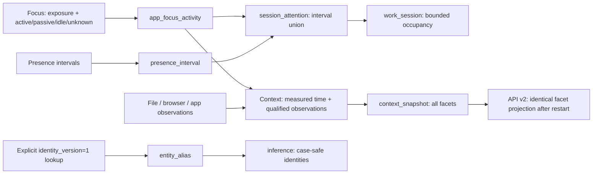

# WARP storage schema v3

The `dev` Phase A update uses **SQLite schema 3**, **API version 2**, and
**identity format 2**. These version numbers describe different contracts.
`ActivityStore::Migrate` / `MigrateV3` are authoritative; consumers should normally
use [API.md](API.md), not write the database directly.

The database remains `%LOCALAPPDATA%\WARP\activity.db`: WAL, one writer,
transactional raw/derived updates, bounded producer queue, three pooled readers.
There are no SQL foreign keys; the writer maintains the logical relationships.

## Changes from v2

| Area | v3 contract |
|---|---|
| Focus | Adds nullable `passive_secs`, `unknown_secs`, and `doc_resolution`. New `active_secs` excludes passive presence. Missing measurement is SQL `NULL`, not zero or wall duration. |
| Session occupancy | Adds `session_attention`, a durable, non-overlapping interval union. `work_session` adds `accounting_version`. Focus and presence cannot independently credit the same wall time. |
| Web identity | URL path/query and opaque document-ID case are preserved. Scheme, authority and provider prefixes are normalized separately. |
| Compatibility | `entity_alias` resolves old folded keys only through an explicit legacy-identity request. `NULL` targets mean ambiguous/unrecoverable, never an arbitrary winner. |
| Context reads | AUMID and attention/resolution metadata survive the focus read projection. Sparse observations have actions and zero measured focus time. Persisted facets use the same projection as memory. |
| Printing | Table unchanged. The collector admits only a matching qualified own-user identity and local client machine, before persistence. |



## Raw records

Times named `timestamp`, `start_ts`, `end_ts`, `*_ts` are UTC Unix seconds.
`event_ms` is UTC Unix milliseconds. Focus persists its end in both `timestamp`
and `event_ms`; its start is currently persisted only to second precision.
Do not treat integer timestamp precision as exact UI/input timing.

The four core activity tables share the existing `EventContext` fields:

`source_pid`, `source_exe`, `foreground_pid`, `foreground_exe`, `ms_since_input`,
`parent_pid`, `parent_exe`, `created_window_ms`, `confidence`.

These are heuristic attribution, not proof of intent or a calibrated model
probability. Additional receipt/replay/process-instance/coverage fields remain
Phase B work.

| Table | Persisted fields, in addition to the shared context where applicable |
|---|---|
| `file_activity` | `id`, `timestamp`, `event_ms`, `action`, `path`, `old_path`, `entity_key`, `source`, `presence`, `is_dir`, `origin_url` |
| `app_launch_activity` | `id`, `timestamp`, `event_ms`, `exe_name`, `exe_path`, `pid`, `entity_key`, `source`, `creator_pid`, `creator_exe`, `aumid`, `session_id`, `exit_ts`, `lifetime_secs` |
| `browsing_activity` | `id`, `timestamp`, `event_ms`, `browser`, `title`, `url`, `entity_key`, `source`, `host`, `doc_id`, `doc_kind`, `dwell_secs`, `presence`, `window_id` |
| `app_focus_activity` | `id`, `timestamp`, `event_ms`, `exe_name`, `exe_path`, `window_title`, `duration_secs`, `entity_key`, `source`, `start_ts`, `end_ts`, `active_secs`, `idle_secs`, `passive_secs`, `unknown_secs`, `doc_key`, `doc_display`, `doc_type`, `doc_resolution`, `window_class`, `desktop_id`, `aumid`, `presence` |
| `presence_interval` | `id`, `start_ts`, `end_ts`, `state` |
| `clipboard_activity` | `id`, `timestamp`, `event_ms`, `owner_exe`, `formats` |
| `print_activity` | `id`, `timestamp`, `event_ms`, `document`, `printer`, `pages` |

Browser `dwell_secs` still describes the **previous page** in `window_id`.
Phase A does not introduce page episodes or claim complete tab/navigation history.
Clipboard metadata does not establish a paste or content-transfer relationship.
Print owner/client names are checked in memory; they are not added to the table.

### Focus attention

| Field | Meaning |
|---|---|
| `duration_secs` | Foreground wall-time exposure, not interaction time. |
| `active_secs` | New capture: recent-input-supported foreground time. SQL `NULL` means unavailable. It is not a count of seconds containing a keystroke. |
| `passive_secs` | New capture: device-wide passive-presence support while input is old/unavailable. Background media does not make these active document seconds. |
| `idle_secs` | New capture: old input without passive-presence support. This does not prove that the user was not reading. |
| `unknown_secs` | Unclassified/unmeasured remainder of foreground exposure. |
| `doc_resolution` | `browser_window`, `filename_candidate`, `ambiguous`, `unresolved`, `withheld`, or migrated `legacy_candidate`. Candidate matching is not a direct app document API. |

New records are bounded so their known components plus unknown time equal the
stored wall duration. Internally `-1` represents missing active measurement and
is written as `NULL`; it is never promoted to wall time.

The read API adds `attention_status`: `measured`, `unknown`, or `legacy_combined`.
In v2, active time included passive time and the passive component was discarded.
For those rows (`passive_secs IS NULL`), a positive old active total becomes
**unknown** in the read/context projection. Measured zero stays zero. The
original aggregate remains in SQL for audit; a split cannot be recovered from it.
Legacy v1 rows without active measurement also remain unknown.

AUMID is retained through the read structs, live foreground overlay and context
aggregation. An unresolved document uses its app identity. Multiple distinct
same-name paths cause abstention; no file is chosen merely because it was first
in a recent-file list. The candidate list is not persisted.

## Attention union and work sessions

```sql
CREATE TABLE session_attention (
    start_ts INTEGER PRIMARY KEY,
    end_ts INTEGER NOT NULL,
    active_rate REAL NOT NULL,
    passive_rate REAL NOT NULL
) WITHOUT ROWID;
CREATE INDEX idx_session_attention_end ON session_attention(end_ts);

-- Added to the existing work_session table:
-- accounting_version INTEGER NOT NULL DEFAULT 0
```

Each slice is a half-open interval with active/passive fractions. The writer
normalizes overlapping inputs into disjoint slices, takes the maximum active
support, and caps passive support to the remaining wall time. It does not sum
independent sensors' votes. Equal adjacent slices are coalesced.

Examples:

| Evidence | Result |
|---|---|
| 600-second focus, zero active, 600 idle | Context active = 0; exposure = 600. |
| Focus and presence both active over the same 600 seconds | Work-session active = 600, not 1,200. |
| 600 passive seconds plus 300 overlapping active seconds | Session active = 300, passive = 300. |
| Two 100-second active intervals separated by a 100-second gap | Session extent = 300; credited attention = 200. |

Mixed segments do not say *where* inside the interval interaction occurred.
Their rates are therefore proportional estimates, not exact attention episodes.
Context clipping uses cumulative floors so adjacent windows conserve measured
component totals. Second-level quantization and mixed-segment estimation remain
limitations until finer episodes/checkpoints are implemented.

`work_session` retains `id`, `start_ts`, `end_ts`, `active_secs`, `passive_secs`,
and adds `accounting_version`:

- `1`: duration derived from the durable union.
- `0`: contains a bounded legacy estimate. Upgrade bounds old totals by wall
  time and preserves that qualification when a new interval joins the session.

Intervals join sessions across gaps shorter than 15 minutes, but never across
purged time. A late bridging interval merges all eligible neighboring sessions.
Repeated or out-of-order presence/focus overlap does not add duplicate occupancy,
including after restart. Session totals returned by `QueryTimeline` describe the
**whole overlapping session**, not a clipped arbitrary-history reconstruction.

## Typed identities and migration aliases

| Identity | Normalization |
|---|---|
| Windows file | Existing canonical path, invariant lowercase. Full physical file IDs and case-sensitive NTFS/WSL paths are not added in Phase A. |
| Application | AUMID where available, otherwise canonical exe path. AUMIDs remain case-folded. |
| URL | Lowercase scheme/authority; preserve canonical path/query case. Privacy filtering happens first in `UrlCanonicalizer`. |
| Document | Normalize the provider prefix, preserve the provider-normalized payload. The URL canonicalizer still applies provider-specific rules, such as GitHub repository normalization. |

`https://example.org/PlanA` and `/plana` are different; `yt:AbCdEf12345` and
`yt:abcdef12345` are different. Consumers must stop lowercasing arbitrary keys.

```sql
CREATE TABLE entity_alias (
    alias_key TEXT PRIMARY KEY,
    entity_key TEXT,                  -- NULL: do not resolve this old identity
    created_ts INTEGER NOT NULL
) WITHOUT ROWID;
CREATE INDEX idx_entity_alias_target ON entity_alias(entity_key);
```

This is a **v2 case-correction compatibility map**, not the future file
rename/physical/logical artifact alias system.

Default lookups use identity format 2 and never consult aliases. In
`ScoreEntities` / `QueryInferences`, `identity_version: 1` explicitly requests old
folded identities. Known unique aliases resolve to a canonical key; ambiguous or
expired web identities return not found. File/app identities remain compatible.
If another case variant is later observed, its old alias is marked ambiguous,
not silently reassigned. Purge uses canonical identity-format-2 keys.

### Upgrade behavior

Ordered migrations run transactionally:

1. Existing v0/v1 data receives the v2 layout without inventing missing active
   duration.
2. v3 adds the attention/resolution columns and derived tables.
3. Original URL/doc-display evidence rekeys retained browser and URL-focus rows.
   Unique entity identities rekey their rollups, memberships, edges and snapshots.
4. Case-collided or merged web aggregates are **not divided or duplicated by
   guesswork**: the affected aggregates are rebuilt from retained browser
   observations using the real engagement implementation. Older unrecoverable
   aggregate contributions are discarded; raw observations are retained. Affected
   thread labels/centroids are cleared rather than preserving unsupported links.
5. FTS is rebuilt; persisted snapshot entity references are updated. Old
   snapshots retain their historical prose/time estimates and are marked
   `attention_semantics: "legacy_combined"`, not presented as newly measured time.
6. Existing consumers receive a change-feed reset where affected history exists.
   They must discard their old key cache and resync. Surviving feed records are
   resequenced after the reset epoch so multi-page bootstrap cannot get stuck in
   repeated resets, including after old tombstones are pruned.

Old entity engagement totals may still contain legacy combined active/passive
contributions when their identity did not need reconstruction. Phase A does not
pretend those historical inputs can be separated; new contributions and current
context use the corrected attention contract.

## Other derived tables

| Table | Purpose |
|---|---|
| `inference` | Per-entity engagement, timestamps, display/title, decay accumulators, change sequence. `doc_kind`/`file_id` remain reserved in this table. |
| `entity_day` | Local-day opens, edits, active seconds and session counts. |
| `activity_fts` | Names/titles, not a local file-content index. |
| `tombstone` | Deleted keys and change-feed sequence. |
| `context_snapshot` | Generation time, window width, JSON containing all facets, thread id, optional label embedding and model. |
| `work_thread`, `thread_member`, `thread_span` | Existing resumable task heuristics and time spans. |
| `edge` | Existing snapshot co-use heuristic, not verified causal/temporal overlap. |
| `meta` | Cursors, change/reset high watermarks, purge time floors, migration/FTS metadata. |

## Retention and deletion

Raw events and snapshots retain the existing 30-day default. Derived sessions,
`session_attention` and other historical structures use the 395-day default.
Aliases expire at that horizon or when their resolved target disappears.
Tombstones retain their existing 90-day feed horizon.

Time purge trims the attention union before re-deriving surviving session
totals. The existing late-record floors prevent deleted time from being
reintroduced. Entity purge removes matching aliases and uses **case-sensitive,
parsed JSON identity matching** for snapshots, not a lowercased substring.
References inside prose are removed conservatively as well, without folding
case-sensitive web/document identities. Scoped item purges retain anonymous session occupancy, as before; whole/time
purges remove the corresponding occupancy. Clear-all empties both new tables.

## Public projections and validation

See [API.md](API.md) for nullable attention fields, observed actions, resolution
status and persisted facet behavior. See
[tests/SIGNAL_QUALITY.md](tests/SIGNAL_QUALITY.md) for on-demand native replay,
metric definitions, labeled external observations, and the distinction between
Phase A invariants and still-unmeasured live/SLM/search quality.
