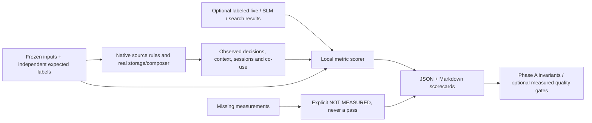

# On-demand capture and inference quality validation

## Run it

From a source checkout with Visual Studio C++ tools, Python 3.11+ and the normal
application NuGet packages restored:

```powershell
nuget restore 'WARP!.sln' -PackagesDirectory ..\packages
.\tests\run_signal_quality.ps1

# Reuse a built test binary, or select ARM64.
.\tests\run_signal_quality.ps1 -NoBuild
.\tests\run_signal_quality.ps1 -Platform ARM64
```

The first command is prerequisite setup, not something the wrapper repeats.
The scorer uses Python's standard library; it does not install dependencies.
`tests\requirements.txt` is needed only for the separate pytest metric/unit tests.

The default run:

1. Builds the native `WarpTests` executable with the **real** `ContextInference`,
   store, entity/history engines and capture-rule helpers. The old context link
   stubs are gone.
2. Runs native regressions, including the six original reproduced defects,
   v1/v2 migrations, alias ambiguity, scoped purge and restart.
3. Replays `fixtures\signal_quality.jsonl` twice against isolated temporary
   databases, with a fixed per-case clock and **models disabled**.
4. Writes observations, native results/log, a machine-readable `scorecard.json`
   and a readable `scorecard.md` under the gitignored `eval\results\` directory.
5. Returns **0** for passing Phase A gates, **1** for a failure/invalid input and
   **2** for incomplete required measurements.

No live hooks, browser/print subscriptions, personal activity database, registry
writes or remote judge are used. Synthetic paths do not need to exist.
Temporary fixture databases are removed when the native process finishes.



## What a pass does and does not establish

The synthetic capture metrics measure **intended policy/admission decisions and
storage**, not Windows ETW/USN/UIA event-generation precision or recall.
In particular, a supplied `private` browser flag tests exclusion handling; it
does not validate real private-window detection. Print fixtures exercise the
qualified-owner/local-client rule, not every printer driver's metadata.

The default inference measurements cover actual deterministic context output:
time, identities, action claims, required entities, output shape and repeat
stability. They are not measurements of Qwen or a future evidence-reasoning SLM.

Correlation diagnostics also exercise the current semantic-cluster/co-use
implementation. The mixed work/personal fixture can expose false co-use links
even while Phase A gates pass: replacing those heuristics is Phase C, not a fix
silently claimed by this tranche. No aggregate "AI quality percentage" is emitted.

Search quality, trained-SLM claim support, continuous-agent CPU/battery cost,
crash checkpoint loss and real collector accuracy require corresponding labeled
observations/measurements. They appear as **not_measured** otherwise. Empty
denominators are also unmeasured, not perfect scores.

## Optional Granite comparison

Use the existing model directory; the runner never downloads a model and fails
if the explicitly requested encoder/tokenizer cannot load or produce a finite,
normalized 384-dimensional probe embedding:

```powershell
python tests\eval\signal_quality.py `
  --native-bin build\tests\x64\Release\WarpTests.exe `
  --models-dir models `
  --output-dir tests\eval\results\granite
```

This runs the same corrected evidence through the production Granite clustering
path. It **does not enable Qwen**, change registry settings, or implement the
proposed Phase C SLM task-hypothesis interface. Reports record the model mode and
actual SHA-256/size of model/tokenizer inputs. Native binary, corpus and evaluator
hashes, source revision and dirty-worktree status identify the evaluated build.

For narrow debugging:

```powershell
build\tests\x64\Release\WarpTests.exe /filter Context.
build\tests\x64\Release\WarpTests.exe /replay tests\fixtures\signal_quality.jsonl /output build\observations.jsonl
```

## Native corpus format

One JSON object per line. `id` is unique; `group_id` groups related tasks/sessions
for evaluation; `split` is `train`, `tune` or `test`; `cohort` contains optional
query-kind, seen/unseen, language and app labels. The shipped corpus is synthetic
regression material used during development, not independent held-out evidence
or a production search benchmark.

```json
{
  "id": "read-only-open",
  "group_id": "project-alpha",
  "split": "test",
  "as_of": 1760000000,
  "window_seconds": 1800,
  "cohort": {"application": "Word", "scenario": "sparse"},
  "signals": [
    {"id": "f1", "type": "file", "end_offset": -60, "action": "OPEN",
     "source": "recent", "path": "C:\\WarpQuality\\Proposal.pdf"}
  ],
  "expected": {
    "accepted": {"f1": true},
    "resolved_keys": {"f1": "c:\\warpquality\\proposal.pdf"},
    "durations": {"focus_seconds": 0, "foreground_exposure_seconds": 0},
    "allowed_entity_keys": ["c:\\warpquality\\proposal.pdf"],
    "required_entity_keys": ["c:\\warpquality\\proposal.pdf"],
    "allowed_actions": {"c:\\warpquality\\proposal.pdf": ["open"]},
    "forbidden_summary_substrings": ["Editing"]
  }
}
```

Offsets are seconds relative to `as_of`. The replay clock is test-only; the
product API has not gained an arbitrary historical `as_of` parameter.

| Signal type | Inputs beyond `id`, `type`, offsets |
|---|---|
| `file` | `path`, `action`, `source`, optional `confidence`; actual path-classification rules run before recording |
| `focus` | `exe_name`, `exe_path`, `title`, `active_secs` (null/missing = unknown), `passive_secs`, `idle_secs`, optional `aumid`, `doc_path`; or `doc_name` + `doc_candidates` to exercise ambiguity |
| `browse` | `url`, `title`, `browser`, optional `private`; actual URL canonicalizer/privacy rules run |
| `launch` | `exe_name`, `exe_path`, optional `aumid`; starts at the post-collector record boundary |
| `presence` | `state`, `start_offset`, `end_offset` |
| `print` | `owner`, `client`, `document`; synthetic own identity is `CONTOSO\Alice` / `alice@contoso.example`, local client `WORKPC` |
| `purge` / `clear` | Test controls, not capture decisions. Purge takes `key`; both call the actual store maintenance implementation. |

`accepted` observations require a persisted row, not just successful queue
submission. `resolved_key` distinguishes a precise document association from
an app-only fallback. The runner does not use expected labels to choose a model
result. New fixtures should include a failing/boundary case, not just another
example of the happy path.

## Labeled live, SLM or search observations

Export **consented, independently labeled** controlled traces from the collector,
model or search application into the same row-per-case protocol, then score:

```powershell
python tests\eval\signal_quality.py `
  --corpus C:\QualityLab\labels.jsonl `
  --observations C:\QualityLab\observations.jsonl `
  --output-dir C:\QualityLab\results `
  --gate-profile measured `
  --require-metric search.ndcg_at_10
```

The scorer does not launch a monitor or obtain private activity to create those
labels. It rejects missing/extra/duplicate case IDs. Every capture decision needs
a label; every emitted model claim needs an independent support judgment.
Missing labeled outputs are errors, not trials silently removed from an average.
Use explicit empty predictions for requests that failed.

Observation envelope: `id`, `mode` (for example `labeled_live`), and the applicable
blocks below. Only blocks with corresponding labels/measurements are scored.

| Block | Observation | Labels (`expected`) |
|---|---|---|
| Capture | `decisions`: `{id,type,accepted,entity_key,resolved_key,action,ambiguous}` | `accepted`, `resolved_keys`, `cross_user_ids`, `excluded_ids` |
| Context | `snapshot`: actual context JSON; `sessions`: `{start,end,active_secs,passive_secs}` | `durations`, `window`, `session_attention_seconds`, `allowed_entity_keys`, `required_entity_keys`, `allowed_actions`, `forbidden_entity_keys`, optional `forbidden_summary_substrings` |
| Correlation | `correlation`: `boundaries` (seconds), `membership` (entity -> task), `co_use` (entity pairs), `task_changes` (`task`,`timestamp`), `abstained` | Same fields under `correlation`, with `abstain` and optional `tolerance_seconds` (default 5) |
| SLM | `model`: `entity_ids`, `evidence_ids`, `claims` (`id`,`kind`: action/relationship/task) | `allowed_entity_keys`, `required_evidence_ids`, `claim_labels` (claim id -> independently judged support boolean) |
| Search | `search`: `ranking` (unique candidate IDs), optional measured `task_success` boolean | `search`: `relevance` (candidate -> grade 0..5), `recall_k` (default 10), optional `exact_match_ids` |
| Lifecycle | `lifecycle`: `visible_keys`, `reset` | `deleted_keys`, `reset_required` |
| Cost/crash | `measurements`: fields below | Measurements come from instrumentation, not generated from expected values |

A search observation example (the labels belong in the corpus, not in this row):

```json
{
  "id": "historical-budget-query",
  "mode": "labeled_live",
  "search": {"ranking": ["budget-2025", "new-unseen-budget", "notes"], "task_success": true},
  "measurements": {"search_api_latency_ms": [12, 14, 19, 37],
                   "timeouts": [false, false, false, false],
                   "fallbacks": [false, false, true, false]}
}
```

This is an **evaluation protocol**, not a new WARP runtime API or a claim that
the current model produces evidence-linked task hypotheses.

## Metrics

The JSON scorecard records value, unit, contributing sample count and
`measured`/`not_measured` for every metric. Ratios pool numerators/denominators;
search scores are per-query macro averages. Zero denominators are not measured.

| Family | Computation |
|---|---|
| Capture | Action precision = correctly admitted / admitted; recall = correctly admitted / expected meaningful/admitted actions in the labeled evaluation scope. |
| Identity | Precision = correct nonempty resolution / nonempty resolutions; coverage = correct / known identities; ambiguity rate = ambiguous decisions / opportunities; false joins = nonempty wrong resolutions, including an unjustified assignment where the label requires abstention. |
| Time | Mean absolute error of labeled component/session totals; positive excess over labeled attention union; mean absolute boundary error in ms; supplied checkpoint crash loss; age of returned snapshot vs `as_of` (not the age of its oldest activity). |
| Correlation | One-to-one boundary F1 within tolerance; pairwise task-membership precision/recall; false co-use pairs; recovery delay and recovery rate after labeled switches; correctness of explicit abstention decisions. |
| Grounding | Supported claims / independently judged emitted claims; invalid entity IDs; unsupported action/relationship rates; structured action-label errors; required entity/evidence recall; output-shape/time-invariant validity; equality of repeated structured outputs. These do not independently judge all nuances of prose. |
| Search | nDCG@10 using `(2^grade - 1)/log2(rank+1)`; MRR@10 at the first positive grade; Recall@K against **all labeled relevant items**, including unseen files; measured task success; missing exact matches or irrelevant results above them. Queries with no labeled relevant items are not measured. |
| Cost | Supplied `capture_cpu_percent`, `model_cpu_ms`, `working_set_bytes`, `battery_mwh`, `package_bytes`, `database_growth_bytes`; interpolated p50/p95 of `search_api_latency_ms`; boolean timeout/fallback rates. Native replay `compose_ms` is diagnostic, not mislabeled as search-API latency or continuous capture CPU. |
| Privacy/lifecycle | Cross-user/excluded decisions admitted; forbidden entity IDs in derived output; deleted IDs still visible; reset behavior vs the labeled expectation. Test every relevant projection in live export, not just one cache. |

### Gates and comparisons

Phase A gates require perfect controlled admission/resolution precision where
labeled, no false joins/invalid IDs/action claims, zero labeled duration/overlap
errors, valid deterministic output and the privacy/deletion/resync invariants.
An unmeasured required invariant makes the run **incomplete**.

The default `--gate-profile phase-a` requires all Phase A invariant families.
Use `--gate-profile measured` for deliberately partial external evaluations:
only observed invariants are gated, and the report is prominently labeled
**partial evaluation**, not a Phase A pass. An entirely empty evaluation cannot
pass. Output directories must not overwrite input/baseline files; a failed rerun
replaces any previous passing scorecard with a failure record.

Correlation diagnostics and unmeasured future capabilities do not magically
become Phase A successes. `--require-metric <name>` makes a missing chosen metric
an explicit incomplete gate. Measured exact-match overrides and unsupported
model action/relationship claims fail their corresponding gates.

For a fixed held-out search experiment, select thresholds **before** running:

```powershell
python tests\eval\signal_quality.py `
  --corpus C:\QualityLab\labels.jsonl --observations C:\QualityLab\treatment.jsonl `
  --baseline C:\QualityLab\baseline\scorecard.json `
  --gate-profile measured `
  --min-ndcg-gain 0.02 --max-cohort-regression 0.01 `
  --output-dir C:\QualityLab\treatment
```

Those numbers are example experiment thresholds, **not measured WARP gains**.
The corpus hash and paired case/group identities must match. Search cases require
explicit `group_id` and `split`; groups cannot cross train/tune and test. The
comparison uses held-out test groups, macro-averages within each user/task group,
and resamples groups (fixed seed, 2,000 bootstrap draws), not correlated events.
At least two independent groups are required; substantially more are needed for
a credible product decision. The gain gate uses the lower 95% bound. Cohort
deltas cover declared exact/ambiguous/historical, seen/unseen, language and app
segments; the optional cohort gate bounds their observed regression.

Do not claim a new model helps by comparing richer inputs against an impoverished
baseline. Compare current/corrected deterministic/same-evidence model arms, then
one optional enrichment at a time. If the model does not improve the relevant
held-out outcome, retain the deterministic baseline.

## CI

The Windows build job runs the same entry point model-free and with the Granite
bundle already downloaded for packaging, and uploads scorecards, native
results and synthetic observations even when a gate fails. Qwen remains disabled.
Python CI runs the
metric self-tests. Existing live API tests remain separate smoke coverage; they
do not establish full collector recall, SLM quality or end-to-end search gains.
